<div align="center">

# 🛡️ MuvAutomation Secure Challenge

### Laboratorio 4 Parte 2: Reverse Engineering Challenge

**Ruta local alternativa: análisis estático y dinámico de binarios ELF compilados en C**


</div>

---

## 👥 Equipo

| Rol        | Integrante                        |
| ---------- | --------------------------------- |
| Estudiante | **Oscar Andrés Sánchez Porras**   |
| Estudiante | **Robinson Steven Núñez Portela** |

---

## 📌 Descripción del proyecto

Este repositorio continúa el trabajo de los laboratorios anteriores y recoge la solución de la **Parte 2 del Laboratorio 4**, la ruta alternativa que no requiere publicar ningún servicio en Internet. En lugar del ejercicio Red Team contra Blue Team sobre una aplicación expuesta, el equipo resolvió un CTF de ingeniería inversa totalmente local.

Se recibieron tres programas compilados en C, sin código fuente, y la misión fue entender cómo funcionan a partir de lo que el propio binario revela. El objetivo no era solo encontrar una contraseña, sino poder explicar con evidencia cómo se llegó a ella.

**Flujo de trabajo seguido:**

**Observar → Formular hipótesis → Localizar la función de validación → Confirmar en ejecución → Extraer una lección de desarrollo seguro**

> ⚠️ **Uso exclusivamente académico.** Los binarios son crackmes creados para esta práctica. No se analizó software ajeno y no se consultó ni se solicitó el código fuente del reto.

---

## 🎯 Objetivos

* 🔎 Identificar formato, arquitectura, linking y símbolos de un binario sin ejecutarlo.
* 🧵 Demostrar por qué `strings` puede revelar secretos embebidos.
* 🧠 Reconstruir un algoritmo de validación con Ghidra y escribir pseudocódigo propio.
* 🐞 Confirmar la hipótesis en ejecución con GDB.
* 🔧 Entender qué información elimina `strip` y cómo recuperar la lógica sin nombres de funciones.

---

## 🧰 Entorno

| Elemento     | Detalle                                                          |
| ------------ | ---------------------------------------------------------------- |
| Sistema      | Kali Linux                                                       |
| Binarios     | ELF 64 bit LSB, x86-64, tipo EXEC, enlazados dinámicamente       |
| Herramientas | file, sha256sum, strings, readelf, objdump, nm, Ghidra, GDB, Python |
| Compilador   | GCC 14.2.0 de Debian, según los metadatos que filtran los binarios |

Preparación del entorno:

```
sudo apt update
sudo apt install -y binutils gdb file
mkdir -p ~/fdsi-reverse/evidence
cd ~/fdsi-reverse
chmod +x crackme_level1 crackme_level2 crackme_level2_stripped
```

Los binarios se trabajaron dentro del repositorio, en la carpeta `fdsi-reverse/`.

---

## 📂 Estructura del repositorio

```
muvautomation-secure-challenge/
├── app/                          # Backend de los laboratorios anteriores
├── nginx/                        # Configuración de los laboratorios anteriores
├── fdsi-reverse/                 # Material del reto
│   ├── crackme_level1
│   ├── crackme_level2
│   ├── crackme_level2_stripped
│   ├── README_ESTUDIANTE.md
│   └── evidence/
│       └── hashes_oficiales.txt
├── docs/
│   └── evidence/
│       └── reverse/
│           ├── baseline.txt             # hashes, file, readelf y símbolos
│           ├── level1.md                # hipótesis, evidencia y resultado del Nivel 1
│           ├── level2.md                # análisis, pseudocódigo y Boss Level
│           ├── gdb.md                   # validación dinámica
│           ├── gdb_sesion_fallida.txt   # log completo de GDB con clave fallida
│           ├── gdb_sesion_valida.txt    # log completo de GDB con clave válida
│           ├── solver_level2.py         # reconstrucción de la clave
│           └── screenshots/             # 39 capturas de evidencia
├── evidence/                     # Evidencia de los laboratorios anteriores
├── reverse-analysis.md           # Análisis consolidado del reto
├── risk-register.md
└── README.md
```

---

## 🧪 Ciclo de trabajo

| Fase | Actividad                                   | Herramientas principales          | Estado     |
| ---- | ------------------------------------------- | --------------------------------- | ---------- |
| 0    | Preparación del entorno                     | apt, mkdir, chmod, git            | ✅ Completa |
| 1    | Baseline forense                            | file, sha256sum, readelf, nm      | ✅ Completa |
| 2    | Nivel 1: Recon                              | strings, objdump                  | ✅ Completa |
| 3    | Nivel 2: Reverse Engineering                | Ghidra, objdump, nm, Python       | ✅ Completa |
| 4    | Confirmación dinámica                       | GDB                               | ✅ Completa |
| 5    | Boss Level: binario sin símbolos            | file, nm, strings, objdump        | ✅ Completa |
| 6    | Evidencia y entrega en GitHub               | git                               | ✅ Completa |

---

## ⚙️ Fase 0: Preparación

Se copiaron los tres binarios al directorio de trabajo, se creó la estructura `docs/evidence/reverse/` en el repositorio y se confirmó que no se abrió ni se solicitó el código fuente del reto.

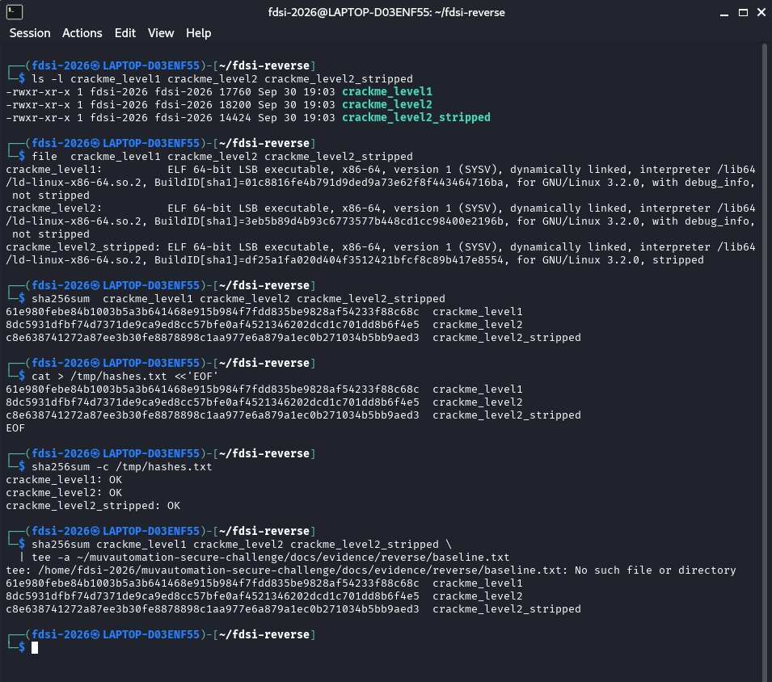

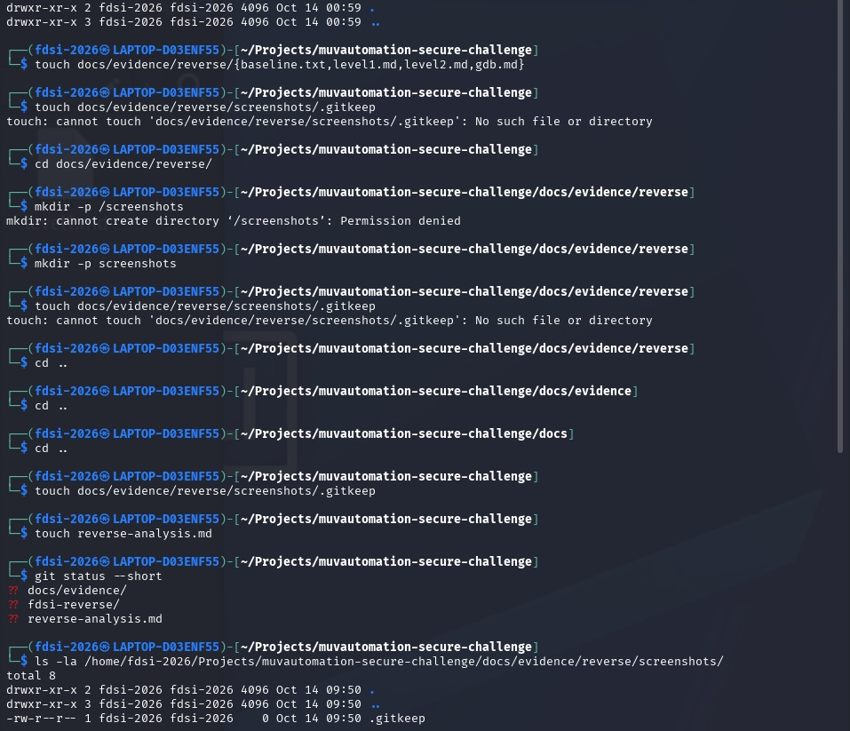

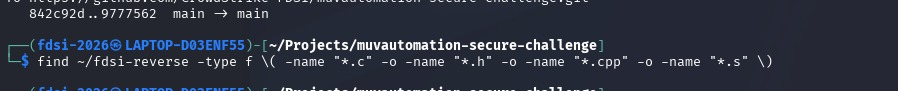

---

## 🔬 Fase 1: Baseline forense

Antes de ejecutar nada se verificó la integridad de los tres binarios y se identificó su naturaleza.

```
file crackme_level1
file crackme_level2
file crackme_level2_stripped
sha256sum crackme_level1 crackme_level2 crackme_level2_stripped
readelf -h crackme_level1
readelf -h crackme_level2
```

| Binario                 | SHA-256                                                            | Verificación |
| ----------------------- | ------------------------------------------------------------------ | ------------ |
| crackme_level1          | `61e980febe84b1003b5a3b641468e915b984f7fdd835be9828af54233f88c68c` | OK           |
| crackme_level2          | `8dc5931dfbf74d7371de9ca9ed8cc57bfe0af4521346202dcd1c701dd8b6f4e5` | OK           |
| crackme_level2_stripped | `c8e638741272a87ee3b30fe8878898c1aa977e6a879a1ec0b271034b5bb9aed3` | OK           |

| Binario                 | Formato   | Arquitectura | Tipo                      | Linking                                  | Símbolos                          |
| ----------------------- | --------- | ------------ | ------------------------- | ---------------------------------------- | --------------------------------- |
| crackme_level1          | ELF64 LSB | x86-64       | EXEC, entrada 0x401070    | Dinámico, ld-linux-x86-64.so.2 y libc.so.6 | Sí, not stripped y con debug_info |
| crackme_level2          | ELF64 LSB | x86-64       | EXEC, entrada 0x401070    | Dinámico                                 | Sí, not stripped y con debug_info |
| crackme_level2_stripped | ELF64 LSB | x86-64       | EXEC                      | Dinámico                                 | No, stripped                      |

Al ser binarios EXEC y no PIE, las direcciones son fijas entre ejecuciones, algo que se aprovecha después en GDB.

**Por qué sirve un hash.** SHA-256 genera una huella de tamaño fijo a partir del contenido del archivo. Si cambia un solo byte, el hash cambia por completo, y esto se comprobó modificando un byte en una copia. Comparar el hash calculado con el oficial garantiza que todos los equipos analizan exactamente el mismo binario, sin corrupción en la descarga ni modificaciones, y que el análisis es reproducible por otros.

La evidencia completa está en `docs/evidence/reverse/baseline.txt`.

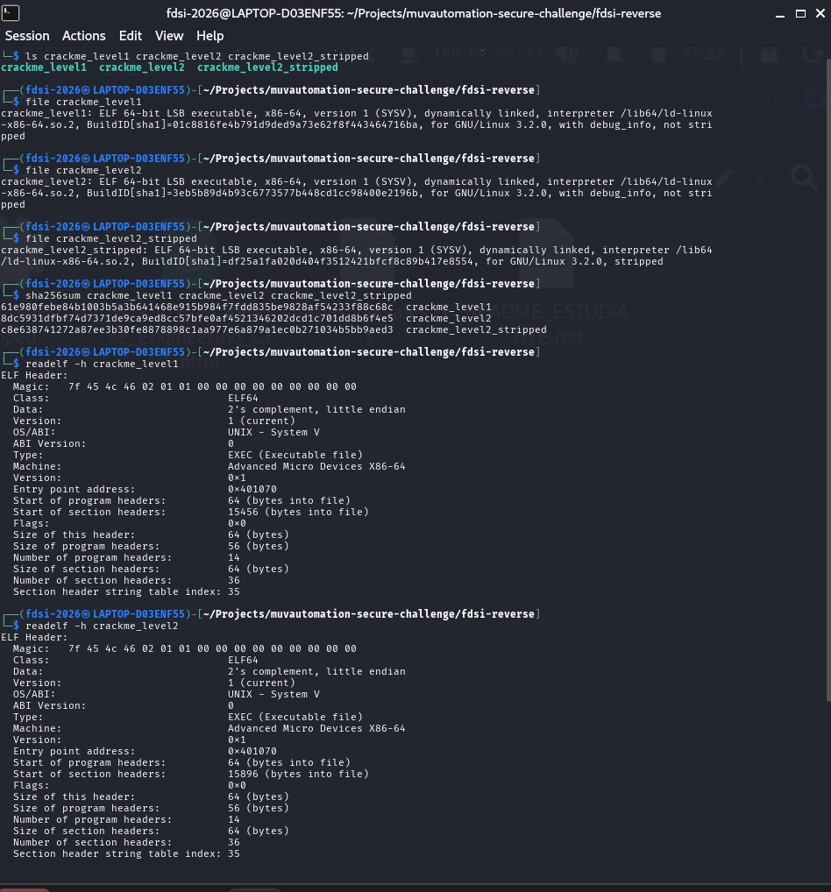

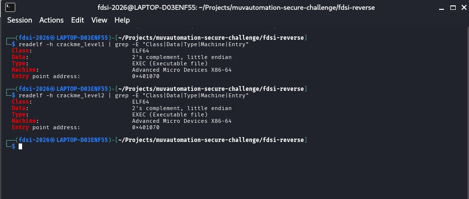

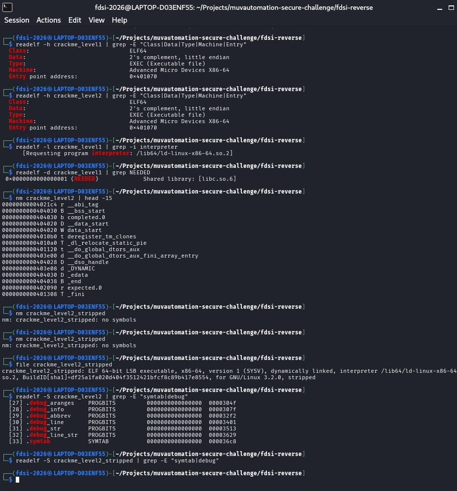

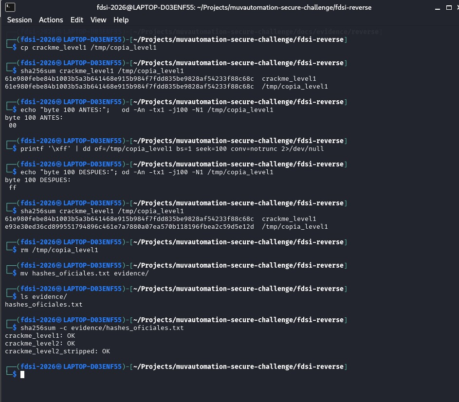

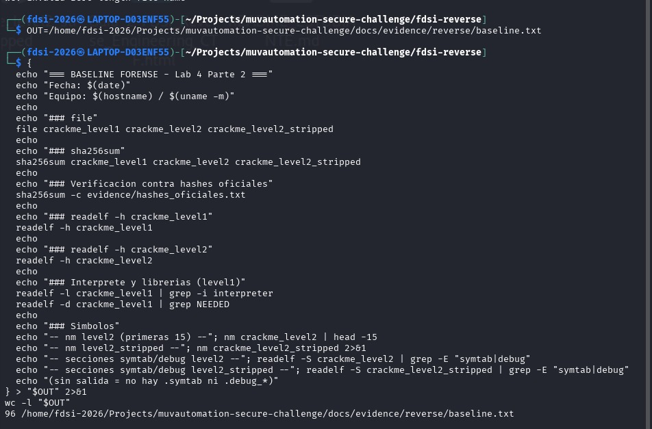

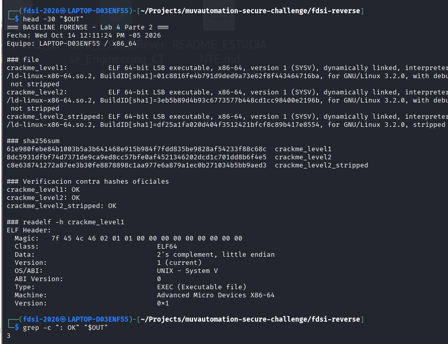

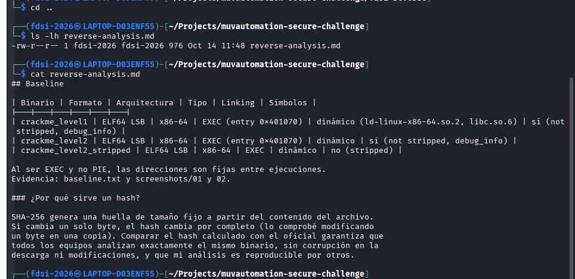

---

## 🟢 Fase 2: Level 1 Recon

### Qué se observó inicialmente

Sin argumentos el programa muestra el uso `Uso: ./crackme_level1 <password>`, es decir que espera la contraseña como argumento. Con la entrada `prueba` responde `Access denied.`

```
./crackme_level1
./crackme_level1 prueba
```


### Qué hipótesis se formuló

En la salida de `strings` aparece la cadena `REDTEAM-101` justo antes de los mensajes del programa, y el binario importa `strcmp`. La hipótesis fue que `REDTEAM-101` es la contraseña embebida y que el programa la compara con la entrada del usuario.

### Qué función o condición se encontró

```
strings -n 5 crackme_level1 | less
objdump -d -M intel crackme_level1 | less
```

`strings` mostró `strcmp`, `REDTEAM-101`, `Access granted.`, `Access denied.` y el símbolo `print_flag`. También filtró metadatos del compilador y la ruta del archivo fuente original, `/mnt/data/reverse_fsi_lab/crackme_level1.c`.

En el desensamblado de `main` se identificó este flujo:

| Dirección | Instrucción                  | Significado                                                  |
| --------- | ---------------------------- | ------------------------------------------------------------ |
| `4011e7`  | `lea rax,[rip+0xe16]`        | Carga la dirección de la cadena `REDTEAM-101` en `0x402004`  |
| `401201`  | `cmp DWORD PTR [rbp-0x14],2` | Exige exactamente un argumento                               |
| `401241`  | `call strcmp@plt`            | Compara el argumento con la cadena embebida                  |
| `401246`  | `test eax,eax` y `jne`       | Si el resultado no es 0 salta a `Access denied.`             |
| `401259`  | `call print_flag`            | Solo se ejecuta si `strcmp` devolvió 0                       |

**Pseudocódigo deducido:**

```
si argc es distinto de 2
    mostrar el uso y terminar con código 1
si strcmp de argv uno contra REDTEAM-101 es igual a 0
    mostrar Access granted
    llamar a print_flag
    terminar con código 0
mostrar Access denied
terminar con código 2
```

**Observación adicional.** `print_flag` no guarda la FLAG como texto. La reconstruye byte a byte con un XOR de clave `0x5a` antes de llamar a `putchar`, por eso `FLAG{...}` no aparece en `strings`. La contraseña sí aparece, porque se compara como una cadena normal.


### Cómo se confirmó el comportamiento

```
./crackme_level1 REDTEAM-101
```

El programa respondió `Access granted.` e imprimió la FLAG.

| Resultado | Valor                        |
| --------- | ---------------------------- |
| Clave     | `REDTEAM-101`                |
| FLAG      | `FLAG{strings_are_evidence}` |


Detalle en `docs/evidence/reverse/level1.md`.

---

## 🟡 Fase 3: Level 2 Reverse Engineering con Ghidra

### Qué se observó inicialmente

El binario conserva símbolos, y `nm` lista `main`, `validate_key` y `reveal_flag`. Sin embargo `strings` ya no entrega la clave: solo aparecen el banner, la pista `Hint: static + dynamic analysis.`, el uso con `<license-key>` y las respuestas `License accepted.` e `Invalid license.`

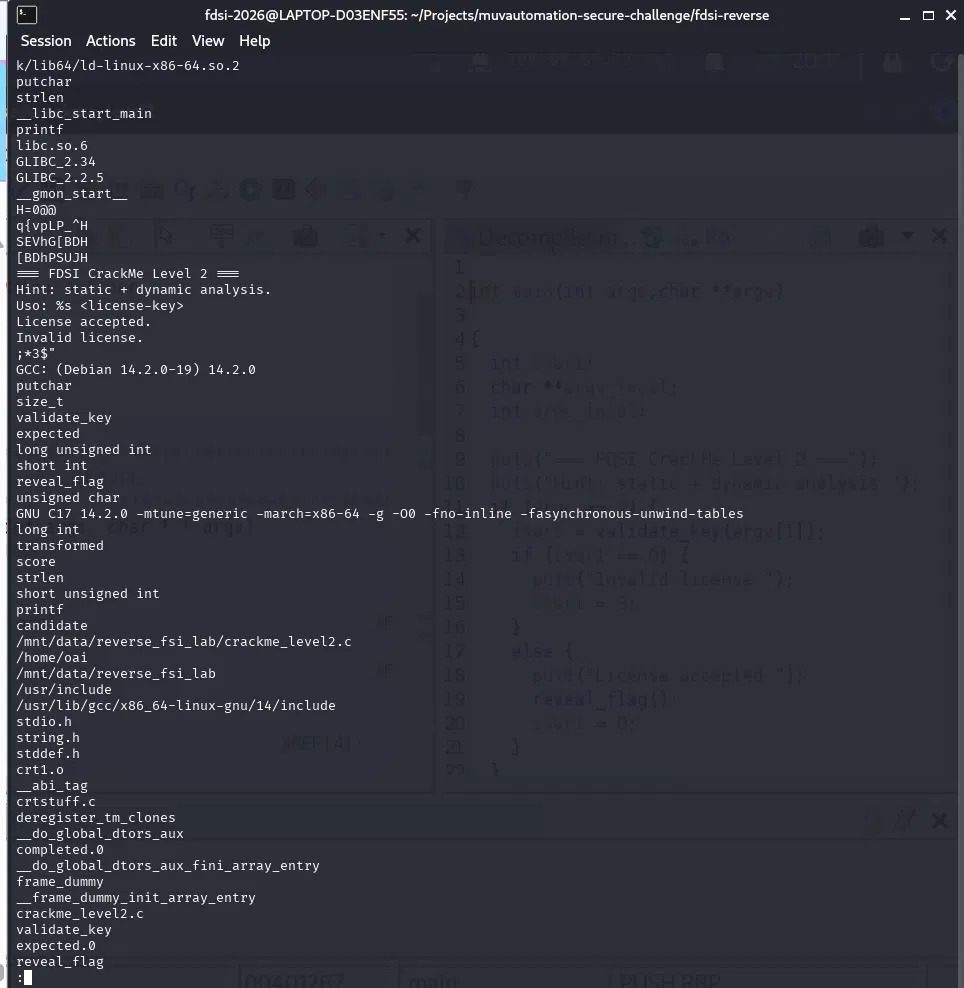

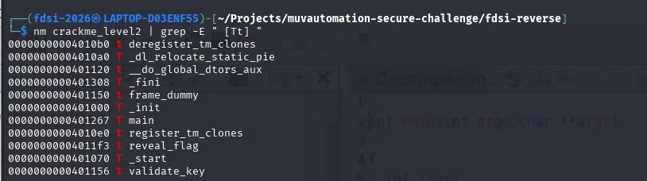

### Qué hipótesis se formuló

Como no existe una cadena contra la cual comparar, la hipótesis fue que la clave se valida mediante un cálculo byte a byte contra un arreglo esperado guardado en `.rodata`, y que ese cálculo es reversible. Siguiendo la pista de la guía, el índice del carácter se combina con un arreglo pequeño que se reutiliza de forma cíclica.

### Qué función o condición se encontró

Se creó un proyecto Non Shared en Ghidra, se importó `crackme_level2` y se aceptó el análisis automático.

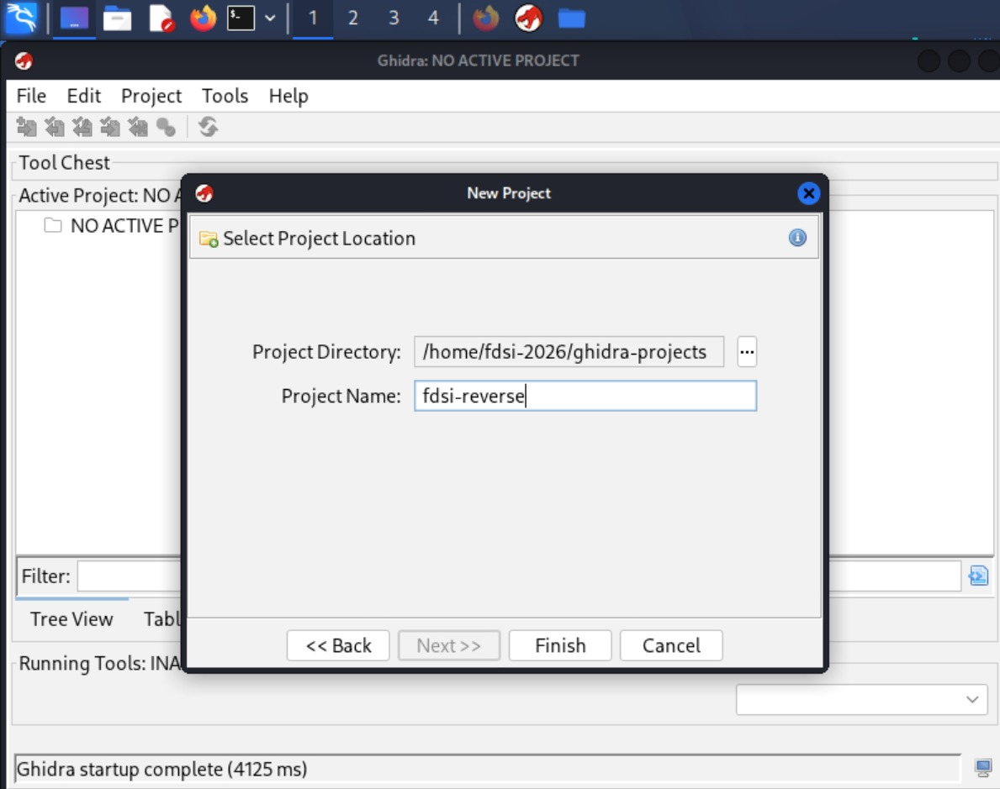

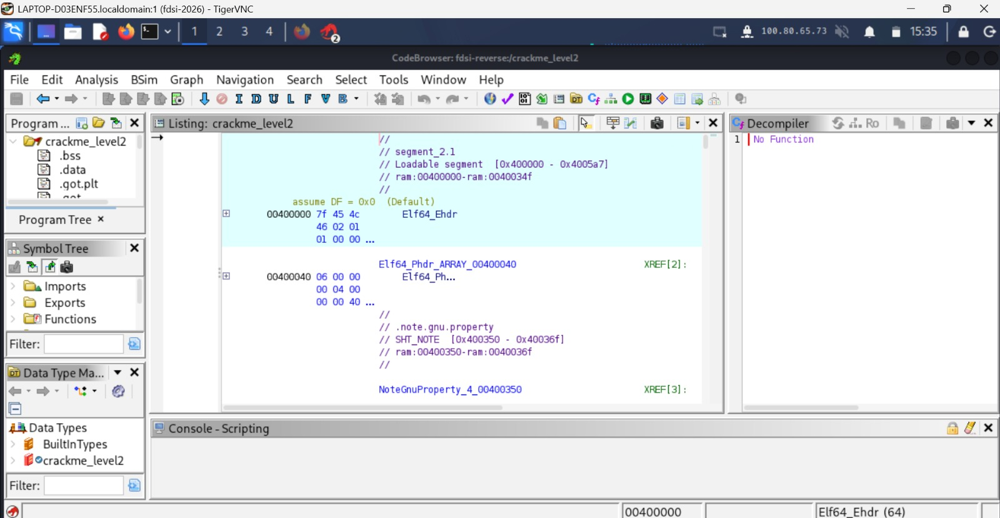

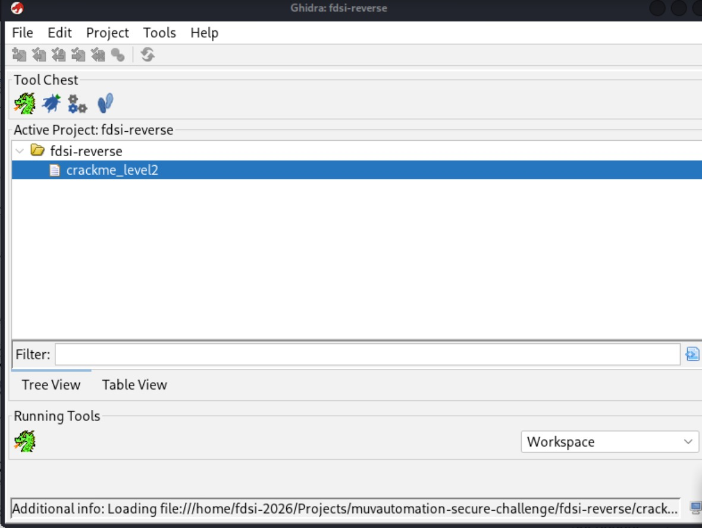

**Función de validación desde main.** `main` está en `0x401267`, `validate_key` en `0x401156` y `reveal_flag` en `0x4011f3`. El decompilado de Ghidra muestra que `main` llama a `validate_key` con `argv[1]`. Si devuelve 0 imprime `Invalid license.` y termina con código 3. Si devuelve un valor distinto de 0 imprime `License accepted.` y llama a `reveal_flag`.

| Dirección | Instrucción        | Significado                                         |
| --------- | ------------------ | --------------------------------------------------- |
| `4012cd`  | `call validate_key` | Recibe `argv[1]` en `rdi`                          |
| `4012d2`  | `test eax,eax`     | Evalúa el retorno                                   |
| `4012d4`  | `je 4012f1`        | Salta a la rama de error si `eax` es 0              |
| `4012e5`  | `call reveal_flag` | Solo se alcanza si la validación pasó               |

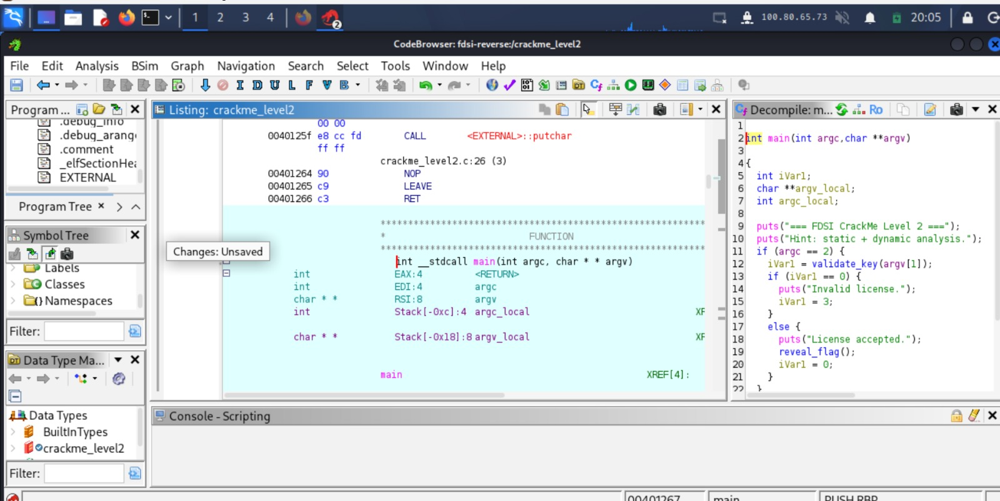

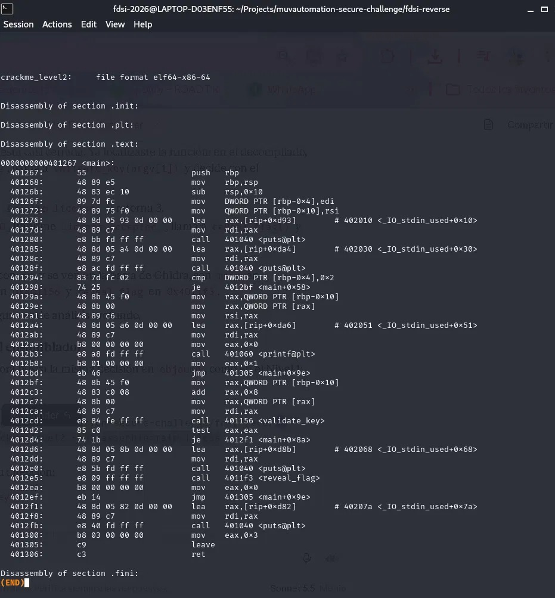

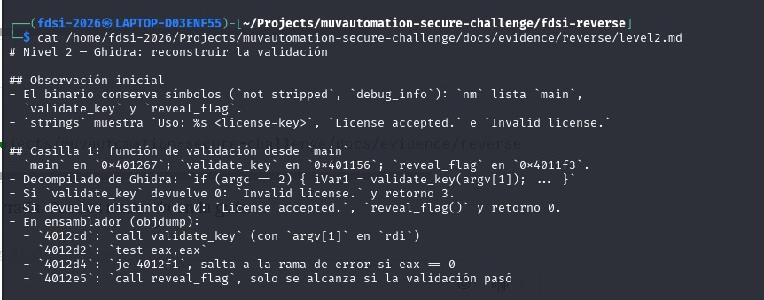

**Longitud esperada.** El decompilado compara `strlen` contra `0x11`, es decir, 17 caracteres, y el bucle recorre exactamente 17 posiciones. Esto se contrastó con el tamaño del símbolo `expected.0`, que mide 17 bytes. Si la longitud no es 17 la función devuelve 0 sin comparar nada.

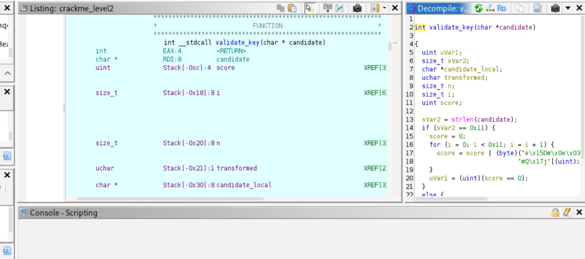

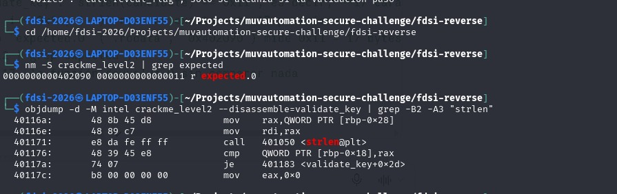

**Transformación aplicada a cada byte.** Es un XOR byte a byte con un arreglo cíclico:

| Dirección | Instrucción                  | Significado                                              |
| --------- | ---------------------------- | -------------------------------------------------------- |
| `4011a8`  | `and eax,0x3`                | Índice cíclico, equivale a `i` módulo 4                  |
| `4011ae`  | `lea rax,[rip+0xed6]`        | Carga el arreglo `k.1` de 4 bytes en `0x40208b`          |
| `4011b9`  | `xor eax,ecx`                | Calcula `k[i y 3]` XOR `candidato[i]`                    |
| `4011be`  | `lea rdx,[rip+0xecb]`        | Carga el arreglo `expected.0` de 17 bytes en `0x402090`  |
| `4011cf`  | `xor al,[rbp-0x19]`          | Calcula `esperado[i]` XOR el valor transformado          |
| `4011d5`  | `or [rbp-0x4],eax`           | Acumula las diferencias                                  |

Los datos extraídos con `objdump -s -j .rodata`:

| Arreglo    | Dirección  | Bytes                                                  |
| ---------- | ---------- | ------------------------------------------------------ |
| `expected` | `0x402090` | `65 15 44 23 0e 03 52 3c 66 03 44 2f 0e 63 27 58 15`   |
| `k`        | `0x40208b` | `23 51 17 6a`                                          |

La licencia es válida solo si el acumulador termina en 0, es decir, si para las 17 posiciones el candidato transformado coincide con el esperado. Como XOR es reversible, la clave se obtiene con:

```
candidato[i] = esperado[i] XOR k[i AND 3]
```

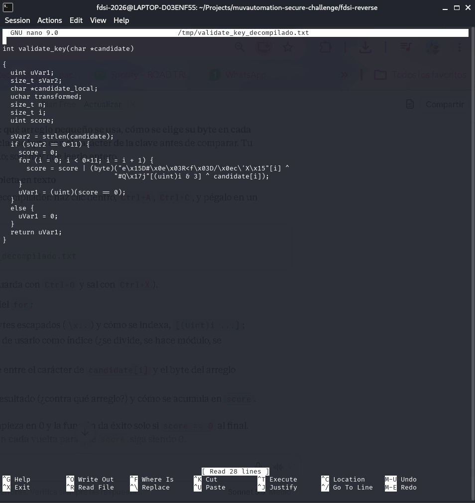

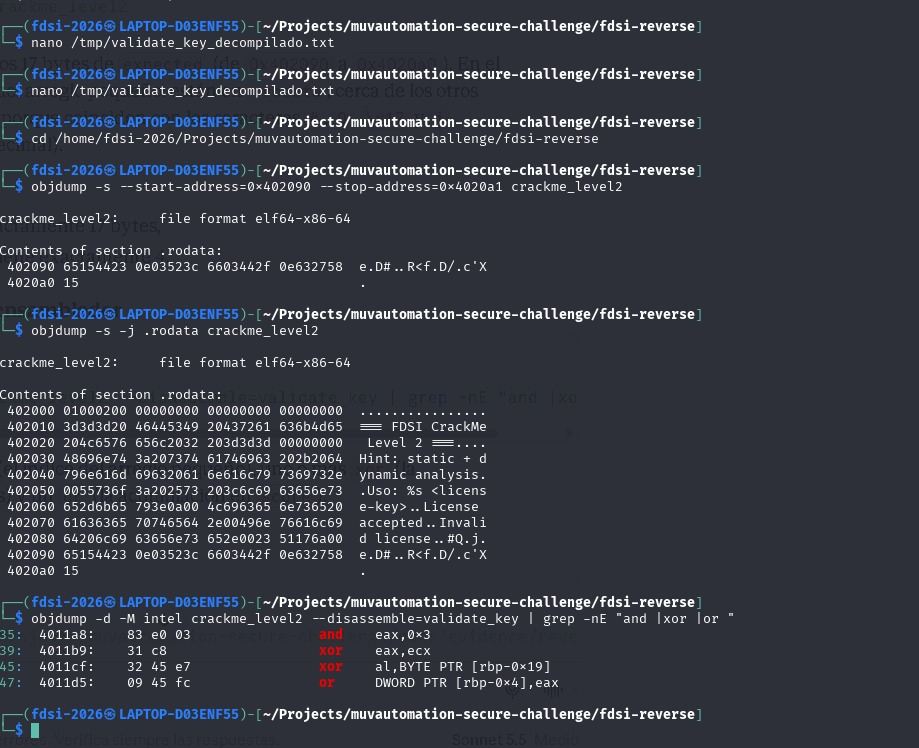

**Pseudocódigo propio del algoritmo:**

```
esperado = 65 15 44 23 0e 03 52 3c 66 03 44 2f 0e 63 27 58 15
tabla    = 23 51 17 6a

si la longitud de la clave es distinta de 17
    retornar 0

diferencia = 0
para idx desde 0 hasta 16
    transformado = clave en idx XOR tabla en idx AND 3
    diferencia   = diferencia OR esperado en idx XOR transformado

retornar 1 si diferencia es 0, de lo contrario retornar 0
```

**Renombres aplicados en Ghidra sobre validate_key:**

| Original      | Renombrado  | Significado                                      |
| ------------- | ----------- | ------------------------------------------------ |
| `candidate`   | `input_key` | Clave introducida por el usuario                 |
| `sVar2`       | `input_len` | Resultado de `strlen`, debe ser 0x11             |
| `uVar1`       | `result`    | Valor de retorno, 1 válida y 0 inválida          |
| `transformed` | `xored`     | Valor intermedio generado por el compilador      |
| `score`       | `diff_acc`  | Acumulador de diferencias, 0 significa que todo coincide |
| `i`           | `idx`       | Índice del bucle de 0 a 16                       |

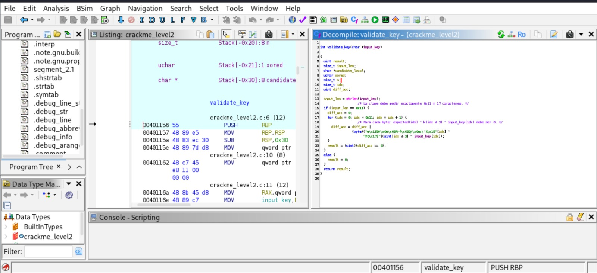

### Cómo se confirmó el comportamiento

Se escribió un script, `solver_level2.py`, que aplica la fórmula inversa sobre los 17 bytes y se autoverifica simulando `validate_key` tal como se leyó en el ensamblador. El acumulador resultó en 0, lo que indica una clave válida.

```
python3 solver_level2.py
./crackme_level2 FDSI-REVERSE-2026
```

También se hicieron pruebas negativas: `AAAAAAAAAAAAAAAAA` con 17 caracteres pasa el filtro de longitud y falla en el bucle XOR, mientras que `FDSI-REVERSE-202` con 16 y `FDSI-REVERSE-20266` con 18 fallan por el filtro de longitud. Todas respondieron `Invalid license.`

| Resultado        | Valor                                                       |
| ---------------- | ----------------------------------------------------------- |
| Clave            | `FDSI-REVERSE-2026`                                         |
| Bytes de la clave | `46 44 53 49 2d 52 45 56 45 52 53 45 2d 32 30 32 36`       |
| FLAG             | `FLAG{ghidra_plus_gdb}`                                     |

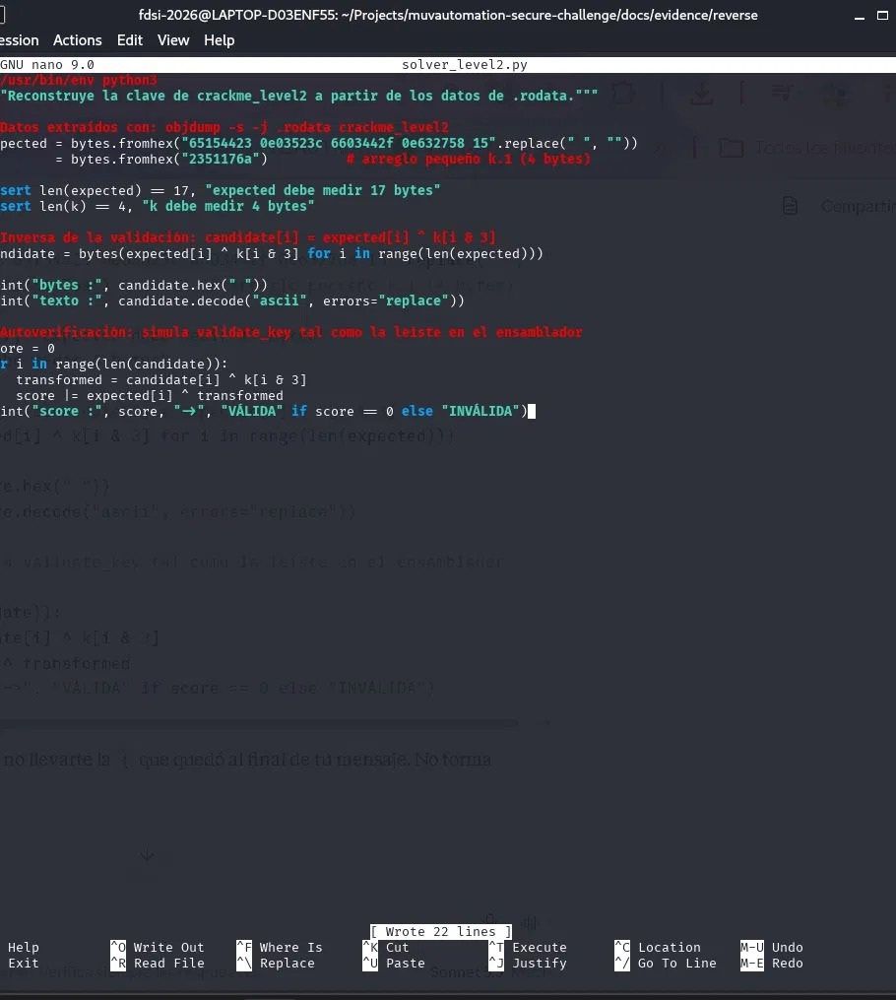

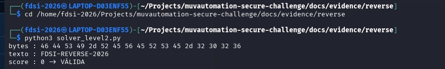

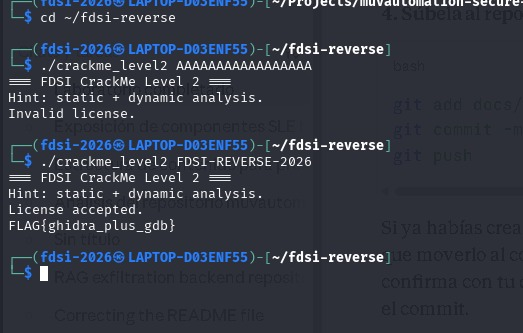

Detalle en `docs/evidence/reverse/level2.md`.

---

## 🐞 Fase 4: Confirmación dinámica con GDB

El análisis estático produjo una hipótesis. GDB sirvió para demostrar en ejecución que esa hipótesis es correcta. Los logs completos están en `gdb_sesion_fallida.txt` y `gdb_sesion_valida.txt`.

```
gdb ./crackme_level2
set disassembly-flavor intel
break validate_key
run AAAA
```

### Sesión 1: clave fallida con AAAA

* El breakpoint en `validate_key` detuvo la ejecución en `0x401162`, y el `bt` muestra que fue llamada desde `main`.
* `x/s $rdi` mostró `"AAAA"`, lo que confirma que el candidato llega como primer argumento.
* En `0x401176` se observó `rax = 4`, el largo de la entrada, frente al valor `0x11` guardado en `[rbp-0x18]`, el largo esperado de 17.
* `finish` devolvió `Value returned is $1 = 0`, el programa imprimió `Invalid license.` y terminó con código 3.


### Sesión 2: clave válida con FDSI-REVERSE-2026

* En `0x401176` se observó `rax = 0x11`, que coincide con el largo esperado.
* Un breakpoint con comandos en `0x4011d5` imprimió `idx` y `eax` por iteración. De `idx 0` a `idx 16`, `eax` valió `0x0` en todas, es decir que ningún byte difiere.
* `x/17xb 0x402090` mostró los bytes esperados y `x/4xb 0x40208b` la tabla de 4 bytes reutilizada de forma cíclica, con los mismos valores obtenidos en el análisis estático.
* `finish` devolvió `Value returned is $1 = 1`, e imprimió `License accepted.` y `FLAG{ghidra_plus_gdb}`.


| Prueba          | Entrada             | Retorno de validate_key | Resultado           |
| --------------- | ------------------- | ----------------------- | ------------------- |
| Clave fallida   | `AAAA`              | 0                       | `Invalid license.`  |
| Clave candidata | `FDSI-REVERSE-2026` | 1                       | `License accepted.` |

Cada byte de la entrada se transforma con XOR contra `tabla[i módulo 4]` y el resultado se compara con el arreglo esperado de 17 bytes. GDB confirmó el largo, la tabla, el arreglo y el valor de retorno. Detalle en `docs/evidence/reverse/gdb.md`.

---

## 🔴 Fase 5: Boss Level, binario sin símbolos

El binario `crackme_level2_stripped` se comporta igual que el anterior, pero ya no se puede depender de nombres como `validate_key`.

```
file crackme_level2_stripped
nm crackme_level2_stripped
strings -n 5 crackme_level2_stripped
objdump -d -M intel crackme_level2_stripped | less
```

### Qué información desapareció al hacer strip

* `file` pasó de `with debug_info, not stripped` a `stripped`.
* `nm` ya no lista `validate_key`, `main` ni `expected.0`, y responde `no symbols`.
* `readelf -S` ya no muestra `.symtab` ni las secciones `.debug_*`.
* Se perdieron nombres de funciones y variables como `validate_key`, `k.1` y `expected.0`, las líneas de código y la ruta del archivo `.c`.
* Se conservan el código, `.rodata`, las cadenas y los símbolos dinámicos de libc como `strlen`, `puts`, `printf` y `putchar`.
* El tamaño pasó de 18200 bytes con símbolos a 14424 bytes stripped.

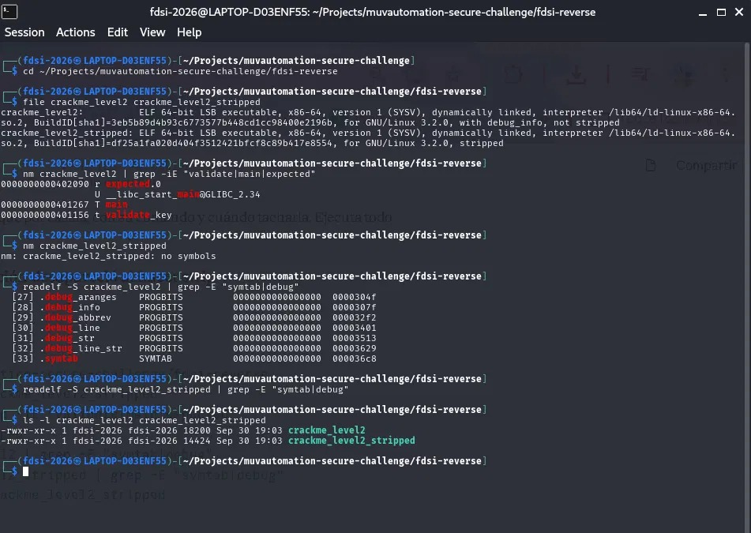

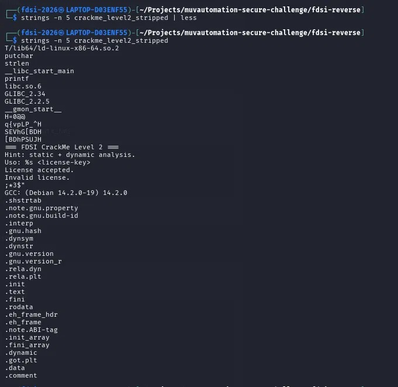

### Cómo se recuperó la lógica de validación

1. `strings` sigue mostrando `License accepted.`, `Invalid license.` y `Uso: %s <license-key>`, que sirven como puntos de partida.
2. En `_start`, la instrucción `mov rdi,0x401267` justo antes de `call __libc_start_main` indica que `main` está en `0x401267`.
3. En `main`, con `argc` igual a 2 se prepara `argv[1]`, se ejecuta `call 0x401156` y luego `test eax,eax` con `je 4012f1`. Si es 0 imprime `Invalid license.` y sale con código 3. Si no, imprime `License accepted.` y llama a `0x4011f3`, la rutina que imprime la FLAG con XOR `0x37`.
4. La función en `0x401156` es la validación. Compara `strlen` con 17, recorre los bytes, aplica XOR con una tabla de 4 bytes en `0x40208b` usando el índice `i AND 3` y compara con el arreglo esperado en `0x402090`. Acumula las diferencias con OR y devuelve si la diferencia es 0.
5. Se comparó el desensamblado de `0x401156` en ambos binarios, y las instrucciones son idénticas. Solo desaparecen las etiquetas.

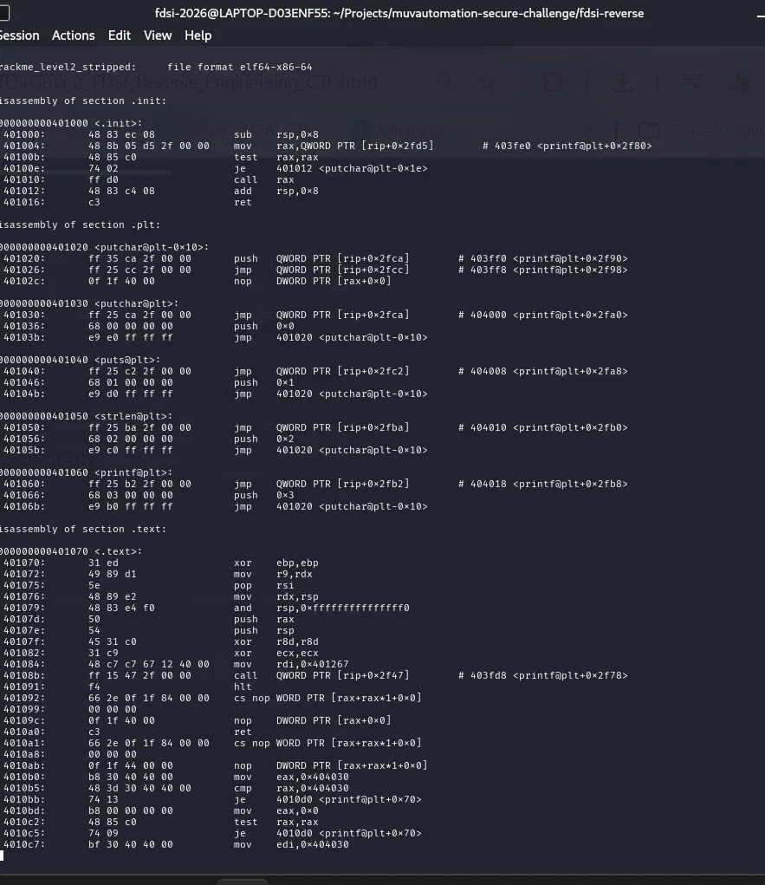

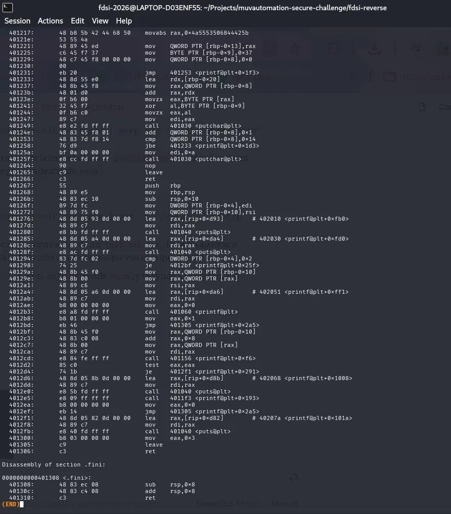

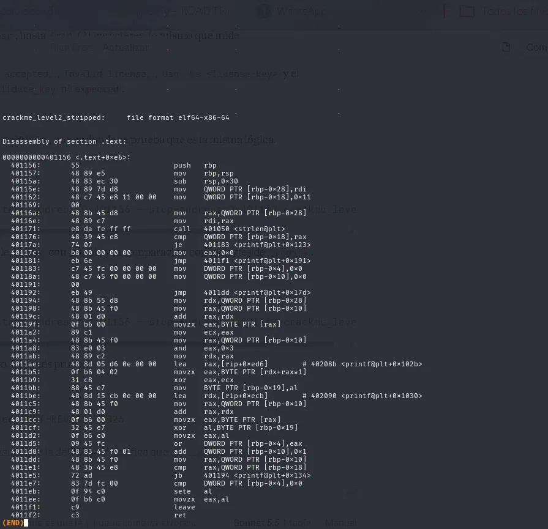

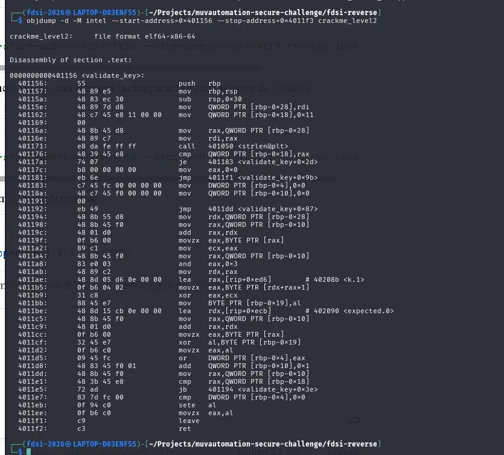

**Pseudocódigo recuperado:**

```
funcion validar recibe clave
    si strlen de clave es distinto de 17
        retornar 0
    diferencia = 0
    para i desde 0 hasta 16
        t = clave en i XOR tabla en i AND 3
        diferencia = diferencia OR esperado en i XOR t
    retornar 1 si diferencia es 0
```

### Prueba

```
./crackme_level2_stripped FDSI-REVERSE-2026
```

Respondió `License accepted.` y `FLAG{ghidra_plus_gdb}`.

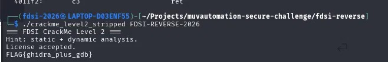

**Conclusión.** Quitar símbolos no oculta la lógica. Dificulta la lectura, pero las referencias a cadenas, las llamadas a libc y el flujo de control permiten reconstruirla.

---

## 🧠 Preguntas de análisis

### 1. ¿Qué información pudiste obtener sin ejecutar el binario?

Con herramientas estáticas se obtuvo mucho más de lo esperado. `file` y `readelf` revelaron que son ELF de 64 bits para x86-64, de tipo EXEC y enlazados dinámicamente contra `libc.so.6`, con punto de entrada en `0x401070`, y si conservan o no símbolos y datos de depuración. `sha256sum` permitió verificar la integridad frente a los hashes oficiales.

`strings` entregó los mensajes de éxito y error, el uso esperado, los nombres de funciones como `print_flag`, `validate_key` y `reveal_flag`, y en el Nivel 1 la contraseña completa `REDTEAM-101`. También filtró metadatos que el programa no necesitaba exponer, como la versión del compilador `GCC 14.2.0` y la ruta del archivo fuente original.

`objdump` mostró el flujo de `main`, la llamada a `strcmp` y la lógica de `validate_key`, y el volcado de `.rodata` entregó los arreglos con los que se reconstruyó la clave del Nivel 2. En ese caso la clave se derivó por completo sin ejecutar el programa.

### 2. ¿Por qué una contraseña compilada como string es un diseño inseguro?

Porque el binario viaja completo hasta quien lo recibe, y cualquiera con una copia puede leer su contenido con una herramienta tan básica como `strings`. Un literal del código fuente se guarda tal cual en `.rodata`, de modo que la contraseña queda en texto plano, igual para todas las instalaciones, sin posibilidad de rotarla sin recompilar y redistribuir el programa, y sin ninguna relación con la identidad de quien la usa. Una vez descubierta, deja de ser secreta para siempre.

El Nivel 2 muestra además que ofuscar no resuelve el problema. Aunque la clave ya no aparece como texto, está protegida solo por un XOR reversible, y tanto los datos como el algoritmo viajan dentro del binario. Cualquiera con el ejecutable puede invertirla, así que apenas se eleva un poco el esfuerzo. Un secreto que el programa necesita conocer para validar al usuario no puede estar dentro del programa que se entrega al usuario.

### 3. ¿Qué cambió entre crackme_level2 y crackme_level2_stripped?

La lógica no cambió. Ambos aceptan la misma clave y entregan la misma FLAG, y las instrucciones de la función de validación son idénticas. Cambió la información auxiliar que acompaña al código:

| Aspecto                   | crackme_level2                              | crackme_level2_stripped                         |
| ------------------------- | ------------------------------------------- | ----------------------------------------------- |
| Salida de `file`          | `with debug_info, not stripped`             | `stripped`                                      |
| Tabla de símbolos         | `.symtab` y `.strtab` presentes             | Eliminadas, `nm` responde `no symbols`          |
| Información de depuración | Secciones `.debug_*` presentes              | Eliminadas                                      |
| Nombres de funciones      | `main`, `validate_key`, `reveal_flag`       | Direcciones sin nombre                          |
| Datos                     | `k.1` y `expected.0` con nombre             | Mismos bytes, sin etiquetas                     |
| Ruta del fuente           | Visible en los metadatos                    | Ya no aparece                                   |
| Tamaño                    | 18200 bytes                                 | 14424 bytes                                     |

El analista pierde las pistas semánticas y debe recuperar el significado de cada función por su comportamiento, sus referencias a cadenas y su flujo de control.

### 4. ¿Qué ventaja tuvo Ghidra sobre objdump?

`objdump` entrega un desensamblado lineal, instrucción por instrucción, y deja al analista la tarea de seguir manualmente cada dirección relativa a `rip`, traducir a mano los bytes de `.rodata` y reconstruir mentalmente qué hace cada registro. Eso se ve en la captura del desensamblado de `validate_key`, donde hay que leer cuarenta instrucciones para deducir un bucle.

Ghidra agrega análisis sobre ese desensamblado. El decompilador devuelve un pseudocódigo en C donde la condición de longitud, el bucle de 17 iteraciones y el XOR con el índice cíclico se leen de forma directa. Además recupera variables y tipos, permite renombrar funciones y variables y ver el efecto en todo el programa, y ofrece referencias cruzadas y el grafo de flujo de control. Gracias a eso se identificó el algoritmo de `validate_key` mucho más rápido, y se pudo anotar el resultado con nombres como `input_key`, `input_len` y `diff_acc`.

---

## ✅ Checklist de la guía

### 0. Preparación

* [x] Copié los tres binarios al directorio de trabajo.
* [x] Ejecuté `file` para confirmar formato y arquitectura.
* [x] Calculé SHA-256 y lo registré en el informe.
* [x] Creé `docs/evidence/reverse/` en el repositorio de GitHub.
* [x] No abrí ni solicité el código fuente del crackme.

### 1. Baseline forense

* [x] Identifiqué arquitectura, formato, linking y presencia o ausencia de símbolos.
* [x] Expliqué por qué un hash ayuda a garantizar que todos analizan el mismo binario.

### 2. Nivel 1

* [x] Identifiqué mensajes relevantes del binario.
* [x] Localicé una cadena relacionada con autenticación y validación.
* [x] Probé mi hipótesis ejecutando el binario.
* [x] Obtuve la FLAG del Nivel 1 sin consultar el código fuente.
* [x] Documenté por qué `strings` puede revelar secretos embebidos.

### 3. Nivel 2

* [x] Localicé la función de validación desde `main`.
* [x] Identifiqué la longitud esperada de la clave.
* [x] Identifiqué la transformación aplicada a cada byte.
* [x] Reconstruí la clave correcta y obtuve la FLAG.
* [x] Guardé captura del decompilador con mis anotaciones y renombres.

### 4. Confirmación dinámica con GDB

* [x] Detuve la ejecución en la rutina de validación.
* [x] Relacioné registros e instrucciones con el pseudocódigo de Ghidra.
* [x] Confirmé dinámicamente una clave fallida y una válida.

### 5. Boss Level

* [x] Expliqué qué información desapareció al hacer strip.
* [x] Encontré de nuevo la lógica de validación usando referencias y flujo de control.

### 6. Evidencia y entrega

* [x] `baseline.txt` contiene hashes, `file` y `readelf`.
* [x] `level1.md` explica hipótesis, evidencia y resultado.
* [x] `level2.md` contiene pseudocódigo propio.
* [x] `gdb.md` demuestra la validación dinámica.
* [x] `reverse-analysis.md` documenta el análisis.
* [ ] Tag `lab-reverse-v1` publicado.

---

## 🎤 Cierre de tres minutos

| Punto a explicar                    | Resumen                                                                                           |
| ----------------------------------- | ------------------------------------------------------------------------------------------------- |
| Qué se observó inicialmente         | Binarios ELF x86-64 que piden una clave y responden con acceso concedido o denegado               |
| Qué hipótesis se formuló            | Nivel 1 compara contra un literal con `strcmp`. Nivel 2 aplica un XOR cíclico contra un arreglo   |
| Qué función o condición se encontró | `strcmp` con `REDTEAM-101` en el Nivel 1. `validate_key` con longitud 17 y XOR con `k[i AND 3]` en el Nivel 2 |
| Cómo se confirmó en ejecución       | Ejecución directa en el Nivel 1. Breakpoints en GDB con retorno 0 y 1 en el Nivel 2               |
| Qué enseñanza de desarrollo seguro  | Un secreto dentro del binario deja de ser secreto, y la validación no debe depender de un valor embebido |

---

## 🔐 Enseñanzas de desarrollo seguro

* **No embeber secretos en el binario.** Todo lo que el programa necesita para decidir si una clave es válida queda al alcance de quien recibe el ejecutable.
* **Validar del lado del servidor.** Si la licencia o la contraseña se verifica en un servicio controlado por el proveedor, el cliente nunca contiene el valor correcto.
* **Guardar solo hashes con sal.** Usar un algoritmo costoso de derivación, nunca la clave en claro ni protegida con una operación reversible como XOR.
* **Emitir credenciales por usuario y con posibilidad de revocación.** Una clave única para todas las copias no se puede rotar sin recompilar.
* **Gestionar secretos fuera del código.** Variables de entorno, gestores de secretos y escaneo automático de secretos en el pipeline de integración continua.
* **No tratar strip ni la ofuscación como control de seguridad.** Eliminar símbolos eleva el costo del análisis, pero no cambia la lógica ni protege los datos que viven en el programa.
* **No filtrar metadatos innecesarios.** Compilar sin información de depuración evita exponer la ruta del fuente y los nombres internos.
* **Revisar el propio binario antes de distribuirlo.** Correr `strings`, `objdump` y Ghidra sobre el artefacto final es una prueba barata de lo que se está regalando.

---

## 🔗 Relación con los laboratorios anteriores

En el Laboratorio 3 la lección fue que una API sin autenticación deja la información a disposición de cualquiera. Este ejercicio muestra el otro extremo del mismo problema: cuando la autenticación existe pero su secreto viaja dentro del producto, el control es solo aparente. En ambos casos la confianza no puede apoyarse en algo que el atacante puede leer, copiar o modificar.

---

## ✅ Checklist de cierre

* [x] Binarios verificados con SHA-256 frente a los hashes oficiales
* [x] Sin acceso al código fuente del reto
* [x] FLAG del Nivel 1 obtenida: `FLAG{strings_are_evidence}`
* [x] FLAG del Nivel 2 obtenida: `FLAG{ghidra_plus_gdb}`
* [x] Pseudocódigo propio documentado
* [x] Confirmación dinámica con GDB, clave fallida y clave válida
* [x] Boss Level resuelto sobre el binario stripped
* [x] Preguntas de análisis respondidas
* [x] Evidencia organizada en `docs/evidence/reverse/`
* [ ] Tag `lab-reverse-v1` publicado

---

**Secure Product Challenge · FDSI**
*Laboratorio 4 Parte 2: Reverse Engineering Challenge · Uso académico autorizado*
