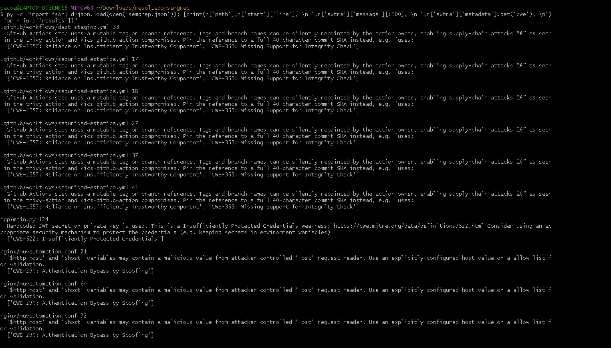
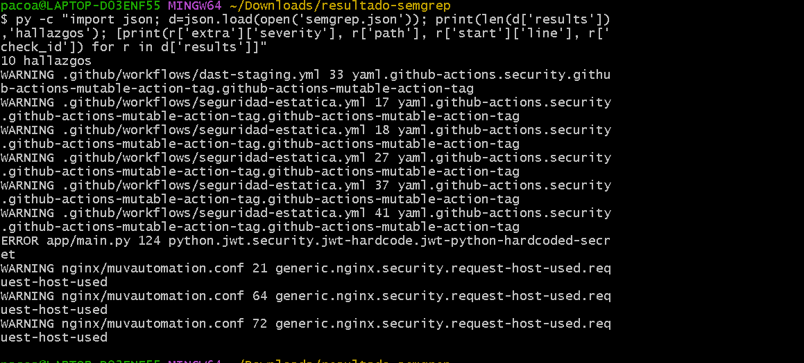

# Informe técnico de hallazgos

**Proyecto:** MuvAutomation Secure Challenge — Falcon Incident Hub (API de alertas con FastAPI y Nginx)  
**Integrantes:** Oscar Andrés Sánchez Porras, Robinson Steven Núñez Portela [verificar la lista antes de entregar]  
**Repositorio / commit:** https://github.com/CrowdStrike-FDSI/muvautomation-secure-challenge / `bbbb4cd3f71246882c0b9fde074059480b7e9b7f`  
**Entorno autorizado:** solo el repositorio (análisis estático, sin ejecutar el código). [Responsable y fecha de autorización]  
**Fecha:** 28 de octubre de 2026

## Resumen ejecutivo
El análisis estático (fase 1) encontró 9 hallazgos distintos (1 crítico, 1 alto, 4 medios y 3 bajos) y el DAST pasivo con ZAP añadió F-10 (bajo) y el SCA sobre el servidor real añadió F-11 (medio, provisional): 11 en total. Los tres riesgos principales son:

1. **F-01 (crítico):** la clave que firma los JWT está escrita en `app/main.py` y publicada en un repositorio público. Quien la lea puede fabricar tokens con rol `analyst` y escribir alertas o leer la auditoría.
2. **F-02 (alto):** las contraseñas de los usuarios demo están en el código y en comentarios del repositorio público.
3. **F-03 (medio):** los workflows de GitHub Actions usan acciones por etiqueta mutable (6 ocurrencias), lo que abre la puerta a un ataque a la cadena de suministro.

La remediación se preparó en el Pull Request `fix/lab-fsi-remediacion` (https://github.com/CrowdStrike-FDSI/muvautomation-secure-challenge/pull/4): corrige F-01 y F-02 (100 % de los críticos y altos, por encima del mínimo del 50 %) y también F-03 y F-04, con 8 pruebas de regresión automatizadas. Quedan abiertos F-05 a F-09. Tras la corrección, Semgrep pasó de 10 a 0 hallazgos y la validación manual en el servidor pasó de 200 a 401 con el token falsificado. F-10 (cabeceras faltantes, bajo) queda documentado y sin corregir.

## Metodología
Identificación del alcance → SAST (Semgrep, con revisión manual de `app/main.py` y `nginx/muvautomation.conf`) → detección de secretos (Gitleaks y búsqueda en el historial de 26 commits) → SCA (`pip-audit`) → DAST pasivo (ZAP baseline local) → validación manual no destructiva → corrección → reescaneo.

Severidad unificada: ERROR de Semgrep → High; WARNING → Medium; INFO → Low; secretos que permiten falsificar identidad → Critical.

## Hallazgo F-01
- **Título:** Clave de firma de JWT escrita en el código fuente.
- **Categoría OWASP/CWE (si corresponde):** OWASP A07 (fallas de identificación y autenticación); CWE-798 y CWE-522.
- **Severidad y justificación:** Crítica. El repositorio es público y la misma clave se usa para validar los tokens del servicio desplegado. Quien la conozca puede crear un token válido con rol `analyst` sin credenciales.
- **Evidencia minimizada, sin credenciales ni datos personales:** regla `python.jwt.security.jwt-hardcode.jwt-python-hardcoded-secret` en `app/main.py`, línea 124, del artefacto `semgrep.json`. Bandit lo marca como `B105` en la línea 30. El valor de la clave no se reproduce en este informe.

  **Captura del estado ANTES (F-01):** detalle del hallazgo `jwt-python-hardcoded-secret` en `app/main.py`, línea 124 (no muestra el valor de la clave).

  
- **Impacto en confidencialidad, integridad o disponibilidad:** Confidencialidad: lectura de `/alertas` y `/audit`. Integridad: creación y modificación de alertas, y atribución falsa en el log de auditoría. Disponibilidad: bajo.
- **Pasos de validación segura en entorno propio:** Se firmó un token de prueba con la clave del repositorio: `GET /alertas` devolvió **200** antes de la corrección. Tras rotar la clave, el mismo tipo de token devolvió **401**, y el login legítimo con la contraseña nueva devolvió 200 (detalle en `docs/SECURITY.md` §5.1).
- **Corrección (commit / pull request):** commit «fix(F-01)» del PR https://github.com/CrowdStrike-FDSI/muvautomation-secure-challenge/pull/4. `SECRET_KEY = os.environ["SECRET_KEY"]`: la app falla al arrancar si no existe. Prueba de regresión: `tests/test_secret_key.py`. Operativo ya hecho: clave nueva en `/etc/falcon-api.env` (permisos `600`, fuera del repositorio) y servicio reiniciado.
- **Resultado del reescaneo:** confirmado en el PR #3 — Semgrep pasó de 10 hallazgos a **0**; la regla `jwt-python-hardcoded-secret` ya no aparece. Prueba de regresión `tests/test_secret_key.py` en verde (`8 passed` junto con el resto de la suite). Evidencia: `evidence/lab5/despues/despues-02-semgrep.png` y `despues-03-pytest-8-passed.png`.

## Hallazgo F-02
- **Título:** Contraseñas de usuarios demo visibles en el repositorio.
- **Categoría OWASP/CWE (si corresponde):** OWASP A07; CWE-798.
- **Severidad y justificación:** Alta. Las contraseñas están en el código y en comentarios de un repositorio público; sirven para obtener un token legítimo si no se han cambiado en el servidor. Semgrep no lo detectó, se identificó por revisión manual.
- **Evidencia minimizada, sin credenciales ni datos personales:** bloque `fake_users_db` de `app/main.py`. Las contraseñas no se reproducen aquí.

  **Captura del estado ANTES (F-02):** no hay captura propia, porque Semgrep no detectó este hallazgo (se identificó por revisión manual). Las contraseñas no se muestran. El resultado general del escaneo está en:

  
- **Impacto en confidencialidad, integridad o disponibilidad:** Confidencialidad e integridad, según el rol de la cuenta (`analyst` escribe, `viewer` lee).
- **Pasos de validación segura en entorno propio:** Con la cuenta de laboratorio, el login con la contraseña nueva funciona y devuelve un token válido (200 en `/alertas`); las pruebas automáticas confirman que las contraseñas del repositorio devuelven 401.
- **Corrección (commit / pull request):** commit «fix(F-02)» del PR https://github.com/CrowdStrike-FDSI/muvautomation-secure-challenge/pull/4. Usuarios y hashes bcrypt se cargan de la variable `APP_USERS` (JSON); se eliminaron las contraseñas del código y comentarios. Prueba de regresión: `tests/test_usuarios.py` (las contraseñas antiguas del repositorio devuelven 401). Operativo ya hecho: `APP_USERS` con hashes bcrypt nuevos en `/etc/falcon-api.env`.
- **Resultado del reescaneo:** confirmado en el PR #3 — Semgrep en 0 hallazgos; `tests/test_usuarios.py` en verde, incluida la prueba de que las contraseñas del repositorio (`analyst123`, `viewer123`) ya devuelven 401.

## Hallazgo F-03 (resumen)
- **Título:** Acciones de GitHub fijadas por etiqueta mutable.
- **Categoría OWASP/CWE (si corresponde):** OWASP A08; CWE-1357 y CWE-353.
- **Severidad y justificación:** Media. Si el autor de una acción reapunta la etiqueta, el pipeline ejecutaría código no revisado. Se detectaron 6 ocurrencias en `seguridad-estatica.yml` y `dast-staging.yml`.
- **Corrección (commit / pull request):** commit «fix(F-03)» del PR https://github.com/CrowdStrike-FDSI/muvautomation-secure-challenge/pull/4. Los 6 `uses:` quedaron fijados a SHA de 40 caracteres, obtenidos con `git ls-remote` de los repositorios oficiales (no de memoria), con la versión como comentario.

## Hallazgo F-04 (resumen)
- **Corrección:** commit «fix(F-04)»: `$host` → `$server_name` en `nginx/muvautomation.conf` (líneas 21, 64, 72). Matiz: Semgrep lo clasifica como CWE-290 «Authentication Bypass by Spoofing», pero aquí el riesgo real es Host header injection / redirección, no un bypass de autenticación; el bloque del puerto 80 es `default_server` y responde a cualquier `Host`. Validar en el servidor con `sudo nginx -t`.

## Otros hallazgos registrados
F-05 (sin `requirements.txt` en la línea base; el archivo creado después solo lista 4 paquetes y fija `bcrypt==5.0.0`, que rompe `passlib`; ver `docs/SECURITY.md`), F-06 (sin límite de intentos en `/token`), F-07 (`status` sin validar), F-08 (Swagger habilitado en la app) y F-09 (evidencia con hostnames e IPs en repositorio público) y F-11 (SCA: avisos de `pyasn1`, `ecdsa` y `python-jose` en el entorno real; `pyasn1` se actualiza a 0.6.5, y `python-jose`/`ecdsa`, sin parche, quedan como riesgo residual bajo porque la API fija HS256; las 132 alertas de Dependabot proceden de un archivo que no refleja la API) y F-10 (cabeceras `X-Content-Type-Options` y `Cross-Origin-Resource-Policy` ausentes, detectadas por ZAP; severidad baja, sin corregir por decisión del equipo). El detalle está en `docs/SECURITY.md`, sección 3.

## Reflexión final
Semgrep detectó la clave escrita en el código, las acciones sin fijar y el uso de `$host`; no detectó las contraseñas demo, la falta de límite de intentos ni la validación de entrada, que salieron de la revisión manual. Gitleaks y el historial no mostraron claves privadas ni tokens reales, pero eso no cubre una clave en forma de texto simple como `SECRET_KEY`. El SCA no se pudo completar en la línea base porque el proyecto no tenía archivo de dependencias, lo que es en sí mismo un hallazgo. El DAST pasivo (ZAP) sí aportó algo nuevo: las cabeceras de seguridad faltantes (F-10), que el análisis estático no puede ver. Un estado verde en el pipeline no significa aplicación segura, porque los pasos usan `|| true`. Para integrar seguridad en el ciclo de desarrollo: gestionar secretos fuera del repositorio desde el primer commit, fijar dependencias y acciones, y pasar el escaneo estático en cada Pull Request con triage de resultados.