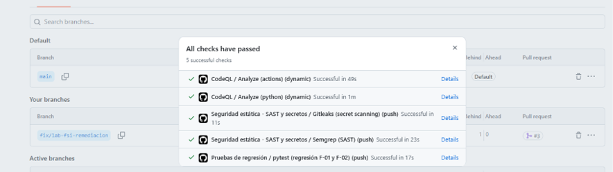
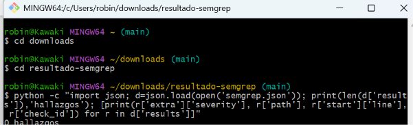
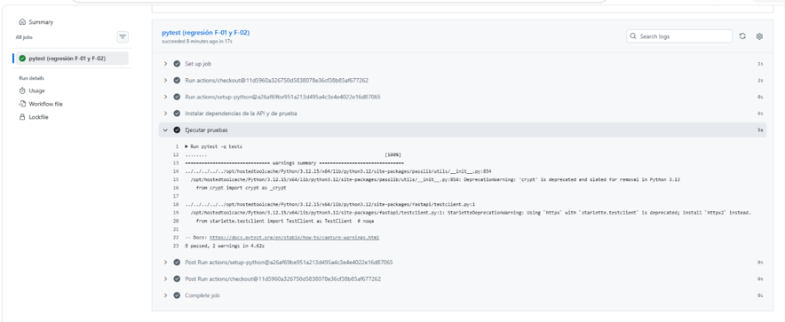
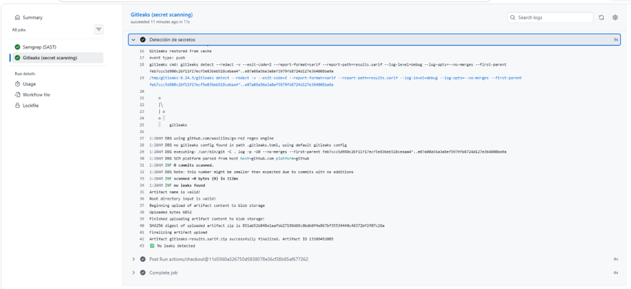
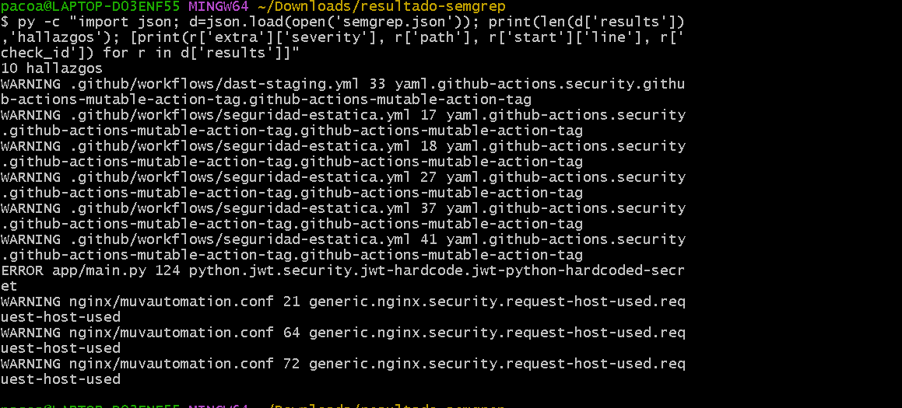
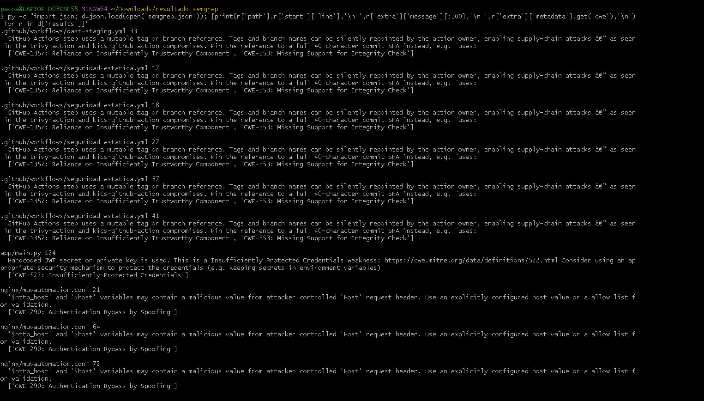

# Seguridad del proyecto — evidencia del laboratorio

> **Actualización 01-nov-2026:** se preparó el Pull Request de remediación (rama `fix/lab-fsi-remediacion`) que corrige F-01, F-02, F-03 y F-04 con pruebas de regresión; ver §4.1. Lo marcado **[COMPLETAR]** depende de pasos en GitHub o en el servidor.
>
> **Fase 1: foto actual (análisis estático).** Solo se leyó el código del repositorio: no se desplegó, no se ejecutaron pruebas ni se instalaron las dependencias del proyecto. DAST y pentest quedan para la fase 2.

## 1. Alcance autorizado
- Repositorio: https://github.com/CrowdStrike-FDSI/muvautomation-secure-challenge
- Rama evaluada y commit: `main` / `bbbb4cd3f71246882c0b9fde074059480b7e9b7f` (15-oct-2026, "Lab 4 Parte 2: README y evidencias con capturas de Reverse Engineering")
- Rama de trabajo del laboratorio y Pull Request: `security/lab-fsi` (línea base) y `fix/lab-fsi-remediacion` (corrección) / https://github.com/CrowdStrike-FDSI/muvautomation-secure-challenge/pull/4
- Tecnología: Python 3 / FastAPI (`app/main.py`), Nginx como reverse proxy (`nginx/muvautomation.conf`), JWT con roles `viewer` y `analyst`, datos en memoria.
- Activos y riesgo principal: la API de alertas (`/alertas`, `/token`, `/audit`) y la clave que firma los JWT. El riesgo principal es que esa clave está publicada en el repositorio.
- URL de staging propio (si aplica): no aplica en la fase 1 (el DAST pasivo corresponde a la fase 2).
- Responsable / autorización: [nombre del responsable / fecha de autorización]
- Fuera de alcance: producción, sistemas de terceros, datos reales, pruebas destructivas y ejecución de los binarios `fdsi-reverse/crackme_*`.

## 2. Línea base y herramientas
Fecha de la línea base: 28-oct-2026.

| Herramienta | Tipo | Fecha | Resultado | Enlace a evidencia |
|---|---|---|---|---|
| Semgrep (`p/owasp-top-ten`, `p/secrets`) | SAST | 28-oct-2026 | 10 hallazgos: 1 ERROR y 9 WARNING | Artefacto `resultado-semgrep` (`semgrep.json`) del workflow "Seguridad estática" |
| Revisión manual de `app/main.py` y `nginx/muvautomation.conf` | SAST manual | 28-oct-2026 | 6 hallazgos adicionales que Semgrep no detecta (F-02, F-05, F-06, F-07, F-08 y F-09) | Este documento |
| Gitleaks | Secretos | 28-oct-2026 | Job ejecutado y en verde con `GITLEAKS_LICENSE`. [Pegar aquí el resultado del log: "no leaks found" o la lista] | Log del job "Gitleaks (secret scanning)" |
| Búsqueda manual en el historial de git (26 commits) | Secretos | 28-oct-2026 | Sin llaves privadas, archivos `.env` ni tokens reales. La clave del JWT y las contraseñas demo sí están en el código (ver F-01 y F-02). | Este documento |
| Dependabot alerts + `pip-audit` | SCA | 02-nov-2026 | **Dependabot** activo: 132 alertas abiertas (9 Critical, 69 High, 47 Moderate, 7 Low), todas en `requirements-full.txt`, un `pip freeze` de un entorno general (tensorflow, torch, Pillow…) que no es el de la API. **`pip-audit` sobre el venv real del servidor** (24 paquetes): 19 entradas (12 identificadores distintos) en 4 paquetes: `pip` 25.1.1 (6 IDs, herramienta de instalación, no se ejecuta en la API), `pyasn1` 0.6.4 (4 CVE, parche 0.6.5), `ecdsa` 0.19.2 y `python-jose` 3.5.0 (1 ID cada uno, sin versión parchada indicada). Ver F-11. | Capturas en `evidence/lab5/sca/`; salida de `pip-audit` en §4.3 |
| CodeQL default setup | SAST | 02-nov-2026 | Activo (Security → Code scanning → Tools: «All tools working correctly»). 0 alertas abiertas y 0 cerradas sobre `main`; los checks de CodeQL del PR #4 pasaron | Pestaña Security → Code scanning |
| OWASP ZAP Baseline (local, ZAP 2.17.0, workflow `dast-local.yml`) | DAST pasivo | 02-nov-2026 | Sobre `http://localhost:8000` con usuarios y clave efímeros: 0 Critical/High/Medium; 2 Low (F-10) y 3 informativos que no son vulnerabilidades | `reports/zap-passive/` (https://github.com/CrowdStrike-FDSI/muvautomation-secure-challenge/pull/6) |

Limitación documentada: la acción `gitleaks/gitleaks-action` exige licencia (`GITLEAKS_LICENSE`) en repositorios de una organización. El primer intento falló por ese motivo y se resolvió añadiendo la licencia como secreto del repositorio.

## 3. Hallazgos y gestión
Escala de severidad unificada: Critical, High, Medium, Low. Semgrep reporta ERROR, WARNING e INFO y se mapeó así: ERROR → High, WARNING → Medium, INFO → Low. Se subió a Critical todo secreto que permita falsificar identidad.

| ID | Categoría | Descripción sin secretos | Riesgo | Archivo/ruta | Cambio propuesto | Estado |
|---|---|---|---|---|---|---|
| F-01 | CWE-798 / CWE-522 (A07 Fallas de identificación y autenticación) | La clave que firma los JWT (`SECRET_KEY`) está escrita en el código y publicada en un repositorio público. Quien la lea puede fabricar un token con rol `analyst`. Detectado por Semgrep (`jwt-python-hardcoded-secret`) y por revisión manual. | **Critical** | `app/main.py` (línea 124 según Semgrep; definición hacia la línea 30) | Leer la clave con `os.environ["SECRET_KEY"]` (la app no arranca si falta), generar una clave nueva y **rotarla** en el servidor mediante systemd. La clave anterior queda en el historial de git y debe considerarse comprometida. | **Corregido en PR** (falta rotar la clave en el servidor) |
| F-02 | CWE-798 (A07) | Usuarios demo (`oscar`, `robinson`, `auditor`) con contraseñas de laboratorio visibles en el código y en comentarios. Semgrep no lo detectó; sale de la revisión manual. | **High** | `app/main.py` (bloque `fake_users_db`) | Quitar contraseñas del código y de los comentarios, cargar usuarios y hashes desde variables de entorno y cambiar las contraseñas actuales. | **Corregido en PR** (falta cargar `APP_USERS` y cambiar contraseñas en el servidor) |
| F-03 | CWE-1357 / CWE-353 (A08 Fallas de integridad de software) | Los workflows usan acciones de GitHub por etiqueta mutable (`@v3`, `@v4`, `@v5`) en lugar de un SHA de commit. 6 ocurrencias detectadas por Semgrep. | **Medium** | `.github/workflows/seguridad-estatica.yml` (líneas 17, 18, 27, 37, 41) y `.github/workflows/dast-staging.yml` (línea 33) | Fijar cada `uses:` a su SHA de 40 caracteres, dejando la versión como comentario. | **Corregido en PR** |
| F-04 | CWE-290 (A07) | Nginx usa `$host`, que proviene de la cabecera Host controlada por el cliente (redirección y `proxy_set_header`). 3 ocurrencias detectadas por Semgrep. | **Medium** | `nginx/muvautomation.conf` (líneas 21, 64, 72) | Sustituir `$host` por `$server_name` (o por el nombre de host fijo). | **Corregido en PR** (validar con `nginx -t` en el servidor) |
| F-05 | CWE-1104 (A06 Componentes vulnerables y desactualizados) | El repositorio no tiene archivo de dependencias, por lo que no se pueden fijar versiones ni hacer SCA. Se usan bibliotecas con riesgo conocido (`python-jose`, `passlib`); verificar versiones al fijarlas. | **Medium** | raíz del repositorio | Crear `requirements.txt` con versiones fijas tomadas del servidor y ejecutar `pip-audit` y Dependabot. **Actualización:** el archivo se creó en la fase 1 pero solo lista `bcrypt`, `Flask-Bcrypt`, `pydantic` y `pydantic_core`; faltan `fastapi`, `python-jose`, `passlib` y `uvicorn`, y `bcrypt==5.0.0` hace fallar el arranque con `passlib` 1.7.4 (`ValueError: password cannot be longer than 72 bytes`, comprobado; con `bcrypt==4.0.1` funciona). Regenerar la lista desde el entorno del servidor (`pip freeze`). **Actualización 02-nov-2026:** `requirements.txt` se regeneró con el `pip freeze` del servidor (24 paquetes, `bcrypt==4.0.1`). | **Corregido** (al fusionar este cambio) |
| F-06 | CWE-307 (A07) | `POST /token` no limita intentos ni bloquea cuentas. | **Medium** | `app/main.py`, `nginx/muvautomation.conf` | Añadir `limit_req` en Nginx y un contador de intentos fallidos en la app. | Abierto |
| F-07 | CWE-20 (A03 Inyección / validación de entrada) | `PATCH /alertas/{id}` acepta cualquier texto en `status`. | **Low** | `app/main.py` | Restringir a los valores `open`, `investigating` y `closed`. | Abierto |
| F-08 | CWE-200 (A05 Configuración de seguridad incorrecta) | Swagger (`/docs`) y OpenAPI están habilitados en la app; solo los protege la lista de IPs de Nginx. | **Low** | `app/main.py` | Desactivar `docs_url` y `openapi_url` en la app, o mantener la restricción de Nginx. | Abierto |
| F-09 | CWE-200 | El repositorio público incluye logs, un PCAP, el hostname `fdsi.tail61fc9f.ts.net` y las IPs Tailscale del equipo. | **Low** | `evidence/`, `README.md`, `nginx/` | Evaluar mover la evidencia a un repositorio privado o anonimizarla. | Abierto |
| F-10 | CWE-693 (A05 Configuración de seguridad incorrecta) | ZAP (DAST pasivo) detectó que la API no envía `X-Content-Type-Options` ni `Cross-Origin-Resource-Policy` en 5 endpoints (`/alertas`, `/alertas/{id}`, `/audit`, `/openapi.json`, `POST /alertas`). El SAST no lo detecta porque es comportamiento en ejecución. | **Low** | `app/main.py` / `nginx/muvautomation.conf` | Añadir en Nginx `add_header X-Content-Type-Options nosniff always;` y `add_header Cross-Origin-Resource-Policy same-origin always;`. | Abierto (decisión: no se corrige; la meta solo cuenta Critical/High) |
| F-11 | CWE-1104 (A06 Componentes vulnerables y desactualizados) | `pip-audit` sobre el entorno real del servidor reporta vulnerabilidades conocidas en `pyasn1` 0.6.4 (parche 0.6.5), `ecdsa` 0.19.2 y `python-jose` 3.5.0 (sin versión parchada indicada), dependencias de la validación de JWT. Dependabot, en cambio, mostró 132 alertas sobre `requirements-full.txt`, que no refleja lo que corre (p. ej. `anyio` 4.13.0 en el archivo vs 4.15.1 en el servidor: la alerta #48 no aplica). La aplicabilidad de cada aviso a la API (que firma con HS256) debe verificarse leyendo el aviso, no se asume. | **Medium** (provisional, hasta revisar los avisos) | `requirements.txt`, `requirements-full.txt`, venv del servidor | Usar el `requirements.txt` generado del servidor; actualizar `pyasn1` a 0.6.5 si las pruebas pasan; revisar los avisos de `ecdsa` y `python-jose` y documentar si aplican; no actualizar en bloque el resto. | Abierto |

### Resumen de la foto actual

| Severidad | Hallazgos (IDs) | Ocurrencias |
|---|---|---|
| Critical | F-01 | 1 |
| High | F-02 | 1 |
| Medium | F-03, F-04, F-05, F-06, F-11 | 12 (6 + 3 + 1 + 1 + 1) |
| Low | F-07, F-08, F-09, F-10 | 3 + 2 de ZAP (F-10) |

Falsos positivos descartados: `B105` de Bandit sobre la cadena `"bearer"` (es el tipo de token, no una credencial) y `B101` (`assert`) en `docs/evidence/reverse/solver_level2.py`, que no afecta a la aplicación.

### Meta de remediación
- Regla: remediar al menos el 50 % de los hallazgos Critical y High; los Medium y Low no cuentan. Si no hubiera Critical ni High, la meta sería el 75 %.
- Hay 2 hallazgos Critical o High (F-01 y F-02), así que el mínimo es **1**. El compromiso es corregir **ambos (100 %)**.
- Orden: F-01 primero, F-02 después. Se pueden corregir en un mismo Pull Request.
- Hallazgos F-03 a F-09: se corrigen en una segunda ronda si hay tiempo (F-03 y F-04 son cambios pequeños). Los que no se corrijan quedan con decisión explícita.

## 4. Validación antes y después

### 4.1 Evidencia y resultado de la remediación
Rama `fix/lab-fsi-remediacion` — Pull Request: https://github.com/CrowdStrike-FDSI/muvautomation-secure-challenge/pull/4. Commits (por título): «fix(F-01)…», «fix(F-03)…», «fix(F-04)…», «ci: workflow de pruebas…», «fix(F-02)…».

| ID | Cambio | Prueba de regresión |
|---|---|---|
| F-01 | `SECRET_KEY = os.environ["SECRET_KEY"]`; la app no arranca si falta | `tests/test_secret_key.py` |
| F-02 | Usuarios y hashes bcrypt desde `APP_USERS` (JSON); sin contraseñas en código ni comentarios | `tests/test_usuarios.py` (las contraseñas del repositorio devuelven 401; contraseñas de prueba aleatorias) |
| F-03 | 6 `uses:` fijados a SHA de 40 caracteres (verificados con `git ls-remote`), versión en comentario | Reescaneo de Semgrep |
| F-04 | `$host` → `$server_name` (líneas 21, 64, 72) | `nginx -t` + `curl -H "Host: ejemplo.test"` en el servidor |

- Pruebas: `8 passed` en local (`pytest -q tests` con `SECRET_KEY` definida); en CI las ejecuta `.github/workflows/pruebas.yml`.
- Meta de remediación (§3): F-01 y F-02 corregidos = 2 de 2 (100 %) una vez fusionado el PR.
- **Pasos de despliegue (no están en el repositorio):** (1) generar una clave nueva: `py -c "import secrets; print(secrets.token_hex(32))"`; (2) generar hashes bcrypt nuevos con contraseñas nuevas y armar `APP_USERS`; (3) poner ambas en un `EnvironmentFile=` del servicio systemd con permisos `600`, fuera del repositorio; (4) reiniciar el servicio. Las contraseñas y la clave antiguas siguen en el historial de git y deben considerarse comprometidas.
- Evidencia del DESPUÉS (PR #3, `fix/lab-fsi-remediacion`): los 5 checks pasaron (CodeQL ×2, Gitleaks, Semgrep, pytest) y el reescaneo de Semgrep dio **0 hallazgos** — desaparecieron `jwt-python-hardcoded-secret`, los 6 `mutable-action-tag` y también los 3 `request-host-used`. Capturas en `evidence/lab5/despues/`:

**Captura 3 — Checks del PR en verde (CodeQL, Gitleaks, Semgrep, pytest)**

**Captura 4 — Semgrep: 0 hallazgos tras la corrección**

**Captura 5 — pytest: 8 pruebas de regresión en verde**

**Captura 6 — Gitleaks: sin secretos detectados**

- Evidencia inicial (captura o artefacto): `semgrep.json` del workflow "Seguridad estática" sobre el commit `bbbb4cd`; salida del escaneo en consola.

### 4.2 Capturas del estado ANTES de la remediación
Las capturas están en `evidence/lab5/antes/`. Son dos imágenes de la salida de Semgrep sobre el commit `bbbb4cd`.

**Captura 1 — Semgrep: 10 hallazgos (lista con severidad, archivo, línea y regla)**

**Captura 2 — Semgrep: detalle de cada hallazgo (mensaje y CWE)**

Las capturas del estado **DESPUÉS** (tras fusionar el PR de remediación) se guardan en `evidence/lab5/despues/`, con los mismos nombres pero con el prefijo `despues-`: nuevo resultado de Semgrep sin `jwt-python-hardcoded-secret` y resultado del test de regresión.

## 5. Pentest autorizado
Entorno propio y aislado: el servidor del equipo (`fdsi`, acceso por Tailscale), con usuarios y datos ficticios, sin tocar sistemas de terceros ni hacer fuerza bruta, DoS ni exfiltración. Solo se enviaron peticiones inocuas (`GET /alertas`, `POST /token` con una cuenta de laboratorio).

### 5.1 Validación manual de F-01 (clave de JWT en el repositorio)
- Hipótesis: quien conozca la `SECRET_KEY` publicada puede firmar un JWT con rol `analyst` y la API lo aceptará.
- Procedimiento: firmar localmente un token de prueba (usuario ficticio, vencimiento 5 min) con la clave del repositorio y enviarlo a `GET /alertas`. Se repitió tras rotar la clave.
- Resultados observados (códigos HTTP):

| Momento | Petición | Resultado |
|---|---|---|
| ANTES (clave del repositorio en uso) | `GET /alertas` con token firmado con la clave publicada | **200** (la API acepta un token falsificado) |
| DESPUÉS (clave nueva en `/etc/falcon-api.env`, servicio reiniciado) | mismo tipo de token firmado con la clave antigua | **401** |
| DESPUÉS | `POST /token` con la contraseña nueva de la cuenta de laboratorio y luego `GET /alertas` con ese token | **200** (el flujo legítimo sigue funcionando) |

- Resultado: **validado** (reproducible antes de la corrección) y **corregido** (la clave antigua ya no sirve).
- Corrección y regresión: https://github.com/CrowdStrike-FDSI/muvautomation-secure-challenge/pull/4; `tests/test_secret_key.py` y `tests/test_usuarios.py` (8 pruebas en verde). Operativo en el servidor: `SECRET_KEY` y `APP_USERS` en `EnvironmentFile=/etc/falcon-api.env` (propietario del servicio, permisos `600`, fuera del repositorio).
- Nota de validación: un primer intento con una clave de otro laboratorio (`lab3-parte2…`) dio 401 incluso antes de la corrección; el 200 se obtuvo con la clave que realmente estaba en `main.py` (`lab4…`). Un 401 con una clave equivocada no demuestra que la API sea segura.
- Evidencia: capturas de la sesión SSH (sin mostrar valores de claves ni contraseñas; ver advertencia del equipo sobre redactar antes de publicar).
- Limitación: la clave y las contraseñas antiguas siguen en el historial de git y se consideran comprometidas; reescribir el historial queda fuera de alcance.

### 5.2 DAST pasivo (OWASP ZAP Baseline, local)
- Qué se ejecutó: ZAP 2.17.0 en modo pasivo contra `http://localhost:8000` (alternativa «baseline local» del laboratorio), con usuarios y clave efímeros. Informe en `reports/zap-passive/` (https://github.com/CrowdStrike-FDSI/muvautomation-secure-challenge/pull/6).
- Resumen: 0 hallazgos Critical, High o Medium.

| Alerta ZAP | Riesgo | Interpretación |
|---|---|---|
| Cross-Origin-Resource-Policy Header Missing or Invalid (CWE-693, 5 URL) | Low | Hallazgo real menor (F-10): sin CORP, otros orígenes podrían cargar las respuestas como recurso. |
| X-Content-Type-Options Header Missing (CWE-693, 5 URL) | Low | Hallazgo real menor (F-10): sin `nosniff`, un navegador podría interpretar el contenido por su cuenta. |
| A Client Error response code was returned (`POST /token`) | Informativo | Esperado: ZAP probó el login con datos inválidos y la API respondió 4xx. No es una vulnerabilidad. |
| Authentication Request Identified (`POST /token`) | Informativo | ZAP reconoce el endpoint de login; es una nota, no un fallo. |
| Non-Storable Content (5 URL) | Informativo | Las respuestas no se guardan en caché; es un comportamiento deseable para una API con datos de alertas. |

- Qué aporta frente al SAST: Semgrep no vio las cabeceras de respuesta porque solo lee código; el DAST sí. No contradice los hallazgos F-01 a F-09.
- Decisión sobre F-10: **no se corrige** en este laboratorio (la regla de remediación solo cuenta Critical y High, y ya se cumple con 2 de 2). Queda documentado, con la corrección propuesta en §3.
- Limitaciones: escaneo pasivo y local (no cubre el despliegue real detrás de Nginx, donde las cabeceras también dependen de la configuración del proxy); no se probó límite de intentos (F-06) por la restricción de no hacer fuerza bruta.

### 4.3 SCA: entorno real frente a archivo de dependencias
- Servidor: `anyio` 4.15.1 (versión parchada ≥ 4.14.2). La alerta #48 de Dependabot se calculó sobre `anyio==4.13.0` de `requirements-full.txt`; **no aplica al despliegue**. Además, `anyio` entra como dependencia indirecta de `starlette` y la API no abre conexiones TLS salientes.
- Comando: `pip-audit --path <venv>/lib/python3.14/site-packages` (ejecutado desde un venv aparte, sin tocar el de la API). Resultado: 19 entradas en 4 paquetes (`pip`, `pyasn1`, `ecdsa`, `python-jose`).
- Pendiente de decisión (F-11): confirmar con los avisos si `pyasn1`, `ecdsa` y `python-jose` aplican con HS256, y probar `pyasn1==0.6.5` con los 8 tests antes de subirlo.
- Limitación: `requirements-full.txt` se conserva sin cambios; sus alertas siguen abiertas en Dependabot y no representan la API.
