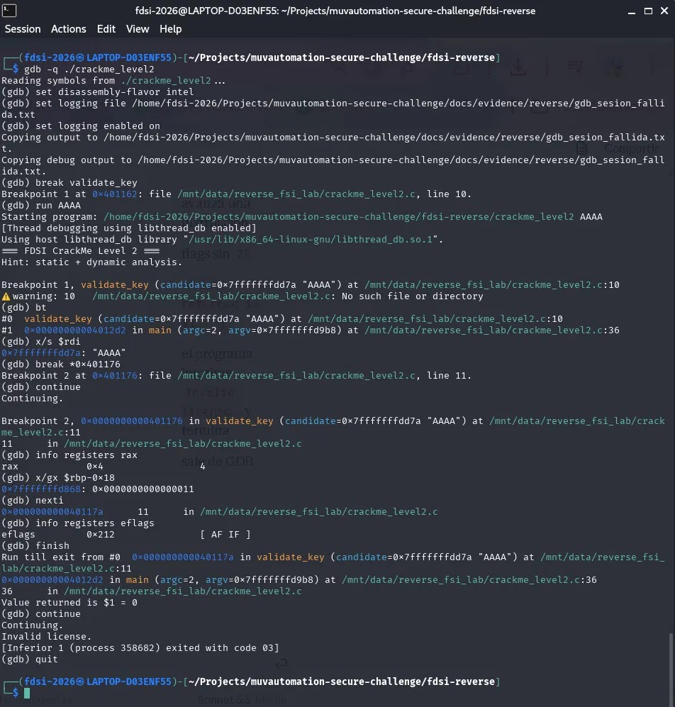
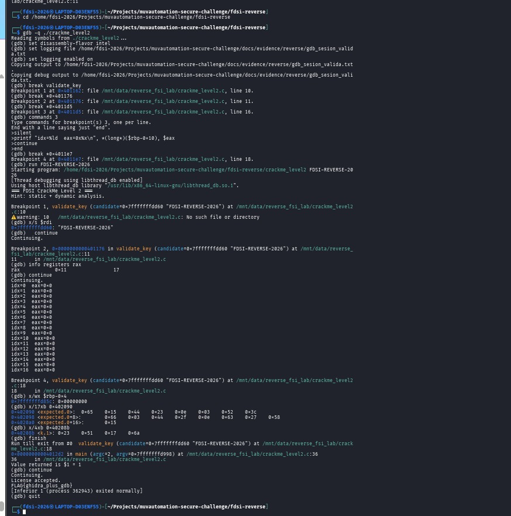

# Confirmación dinámica con GDB — crackme_level2

Logs completos: `gdb_sesion_fallida.txt` y `gdb_sesion_valida.txt`.

## Sesión 1: clave fallida (`AAAA`)
- `break validate_key` -> se detuvo en `0x401162` (validate_key llamada desde main, línea 36 del `bt`).
- `x/s $rdi` -> `"AAAA"` (el candidato llega como primer argumento).
- Breakpoint en `0x401176`: `rax = 4` (largo de mi entrada) frente a `[rbp-0x18] = 0x11` (17): el largo esperado es 17.
- `finish` -> `Value returned is $1 = 0`; el programa imprime `Invalid license.` y sale con código 3.

## Sesión 2: clave válida (`FDSI-REVERSE-2026`)
- En `0x401176`: `rax = 0x11` (17), coincide con el largo esperado.
- Breakpoint con comandos en `0x4011d5` imprimiendo `idx` y `eax` por iteración: idx 0 a 16, `eax=0x0` en todas (ningún byte difiere).
- `x/17xb 0x402090` -> bytes esperados: 65 15 44 23 0e 03 52 3c 66 03 44 2f 0e 63 27 58 15
- `x/4xb 0x40208b` -> tabla de 4 bytes reutilizada cíclicamente: 23 51 17 6a
- `finish` -> `Value returned is $1 = 1`; imprime `License accepted.` y `FLAG{ghidra_plus_gdb}`.

## Relación con el análisis de Ghidra
Cada byte de la entrada se transforma con XOR contra `tabla[i % 4]` y el resultado se compara con el arreglo esperado de 17 bytes. GDB confirma largo, tabla, arreglo y valor de retorno (0 para clave inválida, 1 para válida).

## Conclusión
El análisis estático por sí solo daba una hipótesis del algoritmo. GDB demostró, en ejecución, el valor real de los datos y cómo cambia el retorno de `validate_key` entre una clave fallida y una válida.
