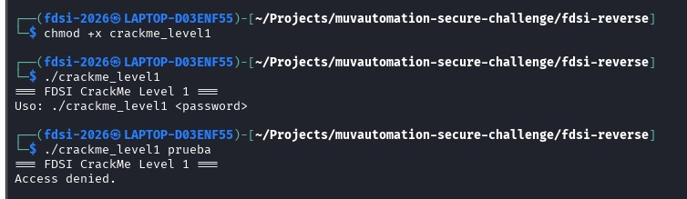
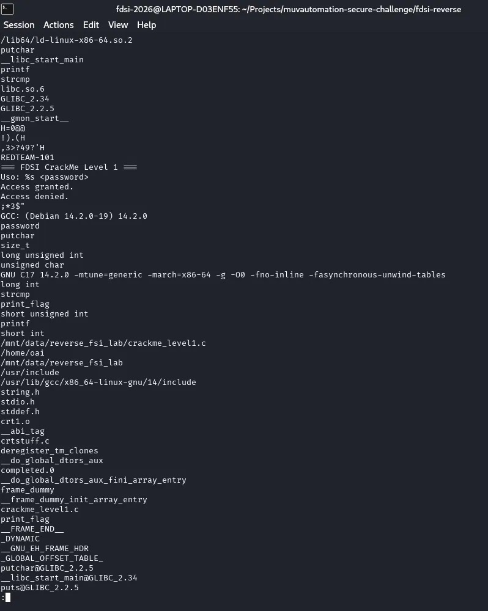
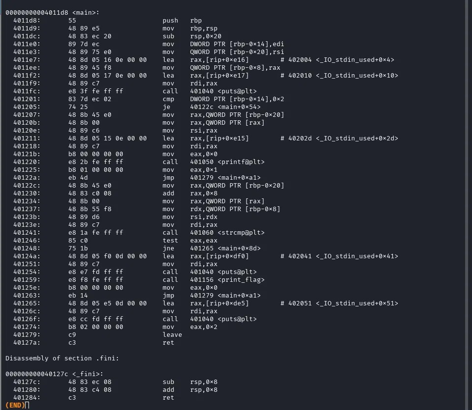
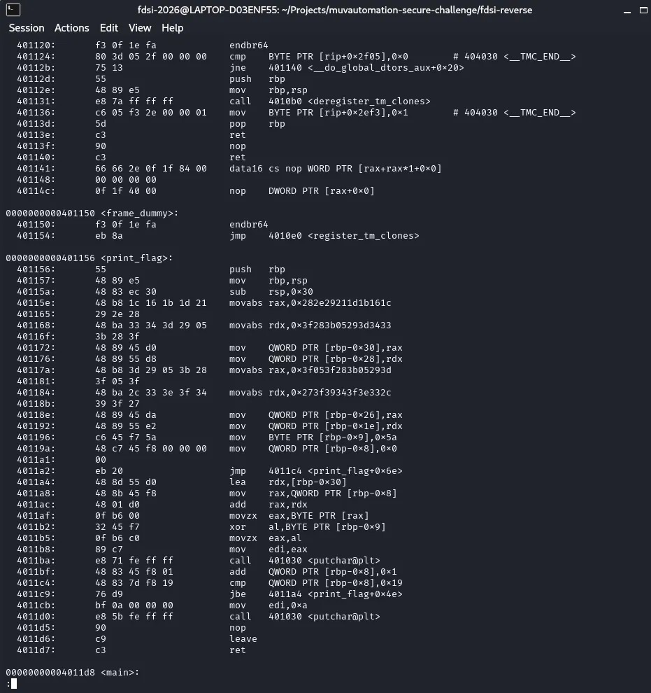
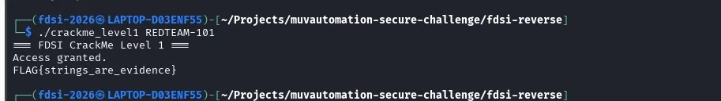

# Nivel 1 — Strings are evidence

## Observación inicial
- Sin argumentos: `Uso: ./crackme_level1 <password>` (el programa espera la contraseña como argumento).
- Con `prueba`: `Access denied.`

## Hipótesis
En la salida de `strings -n 5 crackme_level1` aparece la cadena `REDTEAM-101` justo antes de los mensajes del programa (`Access granted.` / `Access denied.`), y el binario importa `strcmp`. Hipótesis: `REDTEAM-101` es la contraseña embebida y el programa la compara con la entrada del usuario.

## Evidencia
**strings:** aparecen `strcmp`, `REDTEAM-101`, `Access granted.`, `Access denied.` y el símbolo `print_flag`. También se filtran metadatos del compilador (`GCC: (Debian 14.2.0-19) 14.2.0`) y la ruta del archivo fuente (`/mnt/data/reverse_fsi_lab/crackme_level1.c`).

**objdump -d -M intel (función main):**
- `4011e7`: `lea rax,[rip+0xe16]  # 0x402004` carga la dirección de la cadena `REDTEAM-101`.
- `401201`: `cmp DWORD PTR [rbp-0x14],0x2` exige exactamente un argumento (argc == 2).
- `401241`: `call strcmp@plt` compara `argv[1]` con la cadena embebida.
- `401246` y `401248`: `test eax,eax; jne 401265` si el resultado no es 0, salta a "Access denied.".
- `401259`: `call print_flag` solo se ejecuta si `strcmp` devolvió 0.

**Pseudocódigo deducido:**

    if (argc != 2) { printf("Uso: %s <password>\n", argv[0]); return 1; }
    if (strcmp(argv[1], "REDTEAM-101") == 0) {
        puts("Access granted.");
        print_flag();
        return 0;
    }
    puts("Access denied.");
    return 2;

**Observación adicional:** `print_flag` no guarda la FLAG como texto. La reconstruye byte a byte con una operación XOR (clave 0x5a) antes de llamar a `putchar`, por eso `FLAG{...}` no aparece en `strings`. La contraseña sí aparece, porque se compara como cadena normal.

## Resultado
- Clave: `REDTEAM-101`
- Comando: `./crackme_level1 REDTEAM-101`
- Salida: `Access granted.`
- FLAG: `FLAG{strings_are_evidence}`
- Captura del resultado abajo, el resto de capturas están en screenshots/

## ¿Por qué strings puede revelar secretos embebidos?
Un literal del código fuente (aquí, la contraseña) se guarda tal cual en la sección `.rodata` del ejecutable. `strings` extrae cualquier secuencia de caracteres legibles del archivo sin ejecutarlo y sin necesitar símbolos ni el código fuente. Además filtra metadatos del compilador, como la versión de GCC y la ruta del archivo original. Una contraseña compilada como string es un diseño inseguro porque cualquiera con acceso al binario puede recuperarla en segundos.
